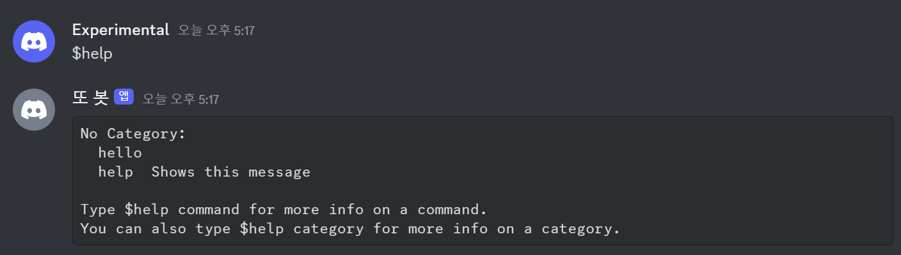
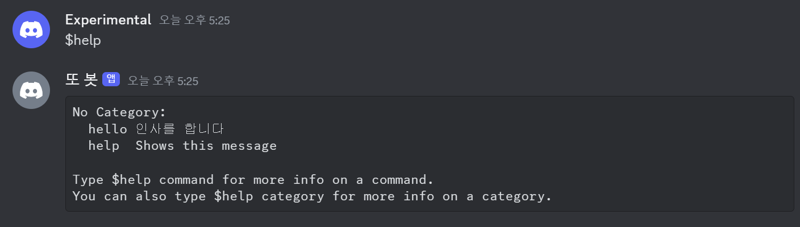

> 이 글에서 다루는 내용
> - `Client`에서 `Bot`으로 전환하기
> - `Command`를 활용해 명령어 생성하기
> - 간단한 error handling 설정하기

## Bot과 확장 라이브러리

[`Bot`](https://discordpy.readthedocs.io/en/stable/ext/commands/api.html?#bot)은 앞서 본 `Client`의 기능들을 상속받는 일종의 subclass이다. `Client`만 활용해서 봇을 개발할 수도 있겠지만, `Client`는 이벤트를 일일이 지정해 줘야 하는 번거로움이 있다. 이와 같은 단점들을 보완하기 위해 `discord.py`는 확장 라이브러리인 `discord.ext`(extension)를 포함하고 있다. 이 라이브러리에 `Bot`이 포함되어 있는데, 편리성을 위해 만들어진 만큼 비교적 간편하게 명령어를 추가할 수 있다. 

### 1. Bot으로 명령어 추가하기

```python
from discord.ext import commands

import discord

intents = discord.Intents.default()
intents.message_content = True
bot = commands.Bot(command_prefix='!', intents=intents) # 명령어 인식 기호
```

`Bot`은 확장 라이브러리에 들어있기 때문에 `import discord`와 별개로 라이브러리를 추가해 주어야 한다. 그리고 `Bot`을 초기화할 때는 `command_prefix`를 지정해야 하는데, 메시지가 여기서 **지정된 string으로 시작**해야 명령어로 인식된다. 이 경우에는 `'!'`로 설정되었으므로 느낌표 뒤의 이름이 등록된 명령어와 일치하면 해당 명령어가 실행된다.

> `command_prefix`를 여러 개 지정하고 싶다면 `('!', '?')`처럼 지정할 수 있다. 빈 string을 지정할 수도 있는데, 이 경우에는 접두사 없이 등록된 명령어 이름으로 호출할 수 있다.
{: .prompt-info}

`Command`는 명령어로 발동시키는 함수를 나타내는 class다. 일반 함수 앞에 `@bot.command` decorator를 붙이면 `Command` 객체가 되는데, `command_prefix` 뒤에 붙은 명령어가 decorator에서 정한 `name`과 일치한다면 `Command`가 발동한다. 예시로 이전에 쓴 코드를 `@bot.command`를 활용해 바꿔 보겠다. 

```python
# bot.py 
# 수정 전
import os, discord
from dotenv import load_dotenv

load_dotenv()
TOKEN = os.getenv('BOT_TOKEN')

intents = discord.Intents.all()

client = discord.Client(intents=intents)

@client.event
async def on_ready():
    print(f'{client.user}(으)로 접속했습니다.')

@client.event
async def on_message(message):
    if message.author == client.user:
        return

    if message.content.startswith('$hello'):
        await message.channel.send('Hello!')

client.run(TOKEN)
```

```python
# bot.py 
# 수정 후
import os, discord
from discord.ext import commands
from dotenv import load_dotenv

load_dotenv()
TOKEN = os.getenv('BOT_TOKEN')

intents = discord.Intents.all()

bot = commands.Bot(command_prefix='$', intents=intents)

@bot.event
async def on_ready():
    print(f'{bot.user}(으)로 접속했습니다.')

@bot.command(name='hello')
async def hello(ctx):
    await ctx.send('Hello!')

bot.run(TOKEN)
```

두 코드 모두 동일하게 작동한다. 자세히 들여다보면 `on_message()` 대신에 `Command`를 활용한 것을 볼 수 있다. `Client`를 사용할 때는 텍스트로 함수를 호출하기 위해서 `on_message()`라는 이벤트를 특정해 줘야 했지만, `Command`를 활용하면 이벤트를 따로 설정할 필요 없이 메시지에서 바로 명령어가 인식되는 모습이다. Decorator에서 `name='hello'`로 argument를 지정했기 때문에 `command_prefix`와 `name`이 합쳐진 `$hello`를 입력하면 설정된 함수가 호출된다. 

> **`ctx`**는 명령어를 실행한 사람이 누군지와 어떤 채널에서 입력됐는지 등의 [**Context 정보**](https://discordpy.readthedocs.io/en/latest/ext/commands/commands.html#invocation-context)를 담고 있다.
{: .prompt-info}



`Command`를 쓰면 또 좋은 점이 내가 쓴 함수 중 명령어에 해당하는 것이 무엇인지 인지하고 있으며, 따로 추가하지 않아도 `help` 명령어로 봇에 설정된 명령어들의 목록을 보는 것이 가능하다는 점이다.

```python
@bot.command(name='hello', help="인사를 합니다")
```



명령어 decorator에 `help` argument를 추가하면 설명도 달 수 있다. 어떤 명령어들이 있고 무엇을 하는지 사용자에게 보여줄 수 있는 가장 간단한 방법이다. 이런 식으로 `Client`에는 없는 추가 기능들이 `Bot`에 자잘하게 있다.

### 2. 명령어에 Parameter 추가하기

`Client`로 명령을 받을 때는 전부 string으로 받기 때문에 함수 안에서 type 변환을 해야 했지만, `Command`를 활용하면 parameter에서 **원하는 type**을 미리 설정할 수 있다. 아래는 간단한 예시다.

```python
@bot.command(name='곱하기', help="숫자 두 개를 곱합니다")
async def multiply(ctx, first_int: int, second_int: int):
    product = first_int * second_int
    await ctx.send("결과는 ", product, "입니다.")
```

`first_int`와 `second_int`에 `: int`를 붙여서 이 parameter들은 정숫값을 받는다고 설정해 두었다. 다만 정수가 아닌 값을 넣지 못하게 막아둘 수는 없어서 error handling은 따로 해야 한다. 더 나아가 parameter에는 단순히 string이나 int 같은 기본적인 type 말고도 길드나 멤버 같은 디스코드 API만의 특수한 type도 들어갈 수 있다.

```python
@bot.command(name='참가일', help="멤버의 서버 참가 날짜를 알려줍니다")
async def joined(ctx, member: discord.Member):
    join_date = member.joined_at.strftime("%Y-%m-%d")
    await ctx.send(f"{member.display_name}님은 {join_date}에 서버에 참가했습니다.")
```

멤버가 길드에 언제 참여했는지를 보여주는 명령어를 만들었다. `discord.Member`를 type으로 설정함으로써 길드에 참여하고 있는 사용자 객체를 받아들이는 변수로 지정했다. 그렇기에 `Member`의 attribute 중 하나인 `joined_at`을 받아와 출력할 수 있다.


이런 식으로 `Member`가 현재 길드에 언제 참가했는지 보여준다. 참고로 `Member.display_name`은 채팅 등 디스코드 인터페이스에 보이는 길드 내 별명, `Member.name`은 사용자명, `Member.id`는 변하지 않는 사용자 고유 ID니, 적재적소에 활용할 수 있도록 하자.

### 3. 명령어 Exception 관리하기

```python
@multiply.error
async def multiply_error(ctx, error):
    if isinstance(error, commands.BadArgument):
        await ctx.send("오류: 정수 두 개를 입력해 주세요.")
```

확장 라이브러리의 장점이 여기 또 있다. `Command`의 **exception을 넘겨받아** 따로 error handling을 할 수 있는 건데, 위의 경우 argument가 정해진 type과 다르게 주어질 때 발생하는 `BadArgument`를 처리하고 있다. 

> `Commands`에서 발생할 수 있는 exception 목록은 [여기](https://discordpy.readthedocs.io/en/latest/ext/commands/api.html?error#exceptions)서 확인할 수 있다.
{: .prompt-info}

 | 

정상적으로 정수가 주어졌을 때와 그렇지 않아 exception이 발생했을 때 각각 다른 응답을 하는 것을 볼 수 있다. 

이외에도 parameter마다 설명을 추가하거나 생성된 리스트에서 변수를 정하는 식으로 오류를 원천 차단하는 방법이 있지만 다음에 다른 명령어 시스템을 다룰 때 정리해 보겠다.

## 부록

### i. 전체 코드
<details>
<summary>코드 보기</summary>
<div markdown="1">

```python
# bot.py
import os, discord
from discord.ext import commands
from dotenv import load_dotenv

load_dotenv()
TOKEN = os.getenv('BOT_TOKEN')

intents = discord.Intents.all()

bot = commands.Bot(command_prefix='$', intents=intents)

@bot.event
async def on_ready():
    print(f'{bot.user}(으)로 접속했습니다.')

@bot.command(name='hello', help="인사를 합니다")
async def hello(ctx):
    await ctx.send("Hello!")

@bot.command(name='곱하기', help="숫자 두 개를 곱합니다")
async def multiply(ctx, first_int: int, second_int: int):
    await ctx.send(f"결과는 {product}입니다.")
        
@bot.command(name='참가일', help="멤버의 서버 참가 날짜를 알려줍니다")
async def joined(ctx, member: discord.Member):
    join_date = member.joined_at.strftime("%Y-%m-%d")
    await ctx.send(f"{member.display_name}님은 {join_date}에 서버에 참가했습니다.")

@multiply.error
async def multiply_error(ctx, error):
    if isinstance(error, commands.BadArgument):
        await ctx.send("오류: 정수 두 개를 입력해 주세요.")

bot.run(TOKEN)
```
</div>
</details>

### ii. 폴더 구조

```tree
📦Discord Bot
 ┣ 📜.env
 ┗ 📜bot.py
```

### iii. 깃허브 리포지토리

<https://github.com/sunwoo-j/discord-bot-diy>