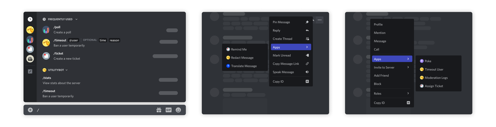
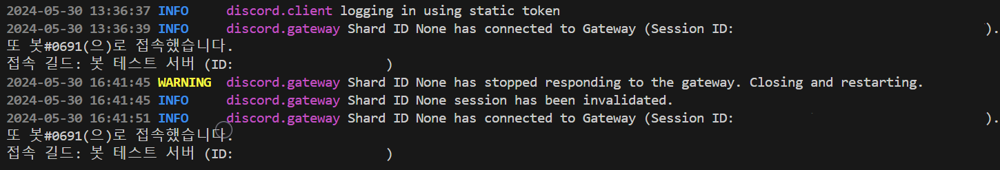
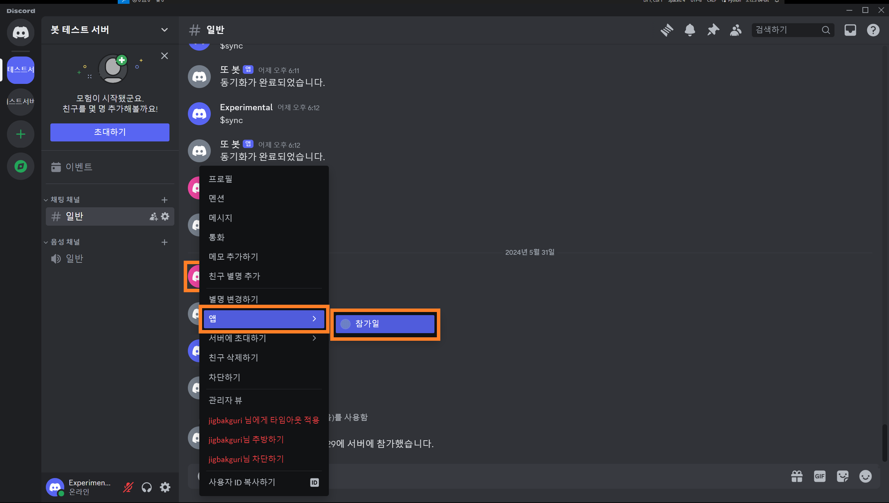
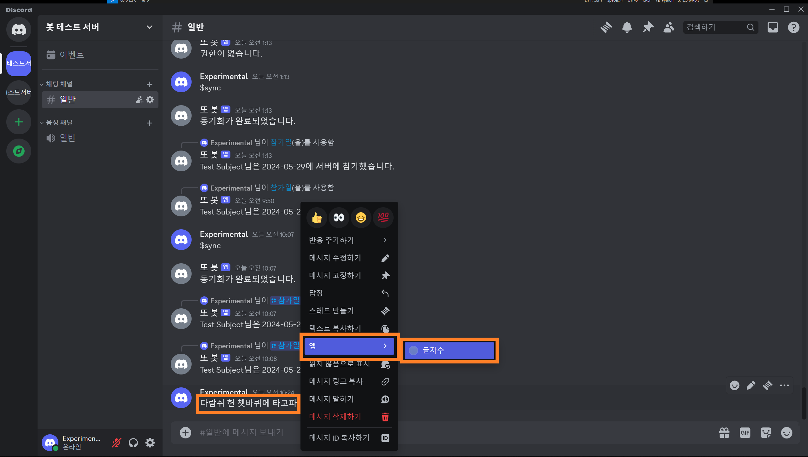

> 이 글에서 다루는 내용
> - Application Command 이해하기
> - Slash Command 설정하기
> - 텍스트 입력이 아닌 Context Menu로 기능 구동하기

## Application Command

**Application Command**는 디스코드 인터페이스에서 앱과 상호 작용을 할 수 있는 정식적인 방법들을 지칭한다. 디스코드에서는 세 가지로 Application Command를 구분 짓고 있다. 

> Application Command에 대한 자세한 내용은 [이곳](https://discord.com/developers/docs/tutorials/upgrading-to-application-commands)에서 볼 수 있다.
{: .prompt-info}



세 종류의 Application Command를 표현한 이미지다. 왼쪽부터 **Slash Command**, **Message Command**, 그리고 **User Command**를 표현했다.

- **Slash Command**<br>
가장 흔히 사용하는 Application Command로, 채팅창에 빗금(/)을 이용해 명령어를 입력하거나 메시지 입력창 왼쪽의 <kbd>+</kbd> 버튼을 누르면 나오는 <kbd>앱 사용</kbd>으로 명령어를 선택할 수 있다.

- **Message Command**<br>
Message Command는 특정 메시지와 관련된 행동을 할 때 유용하다. 원하는 메시지를 우클릭하거나 메시지의 우측 상단 <kbd>...</kbd> 버튼을 누르면 보이는 <kbd>앱</kbd>에서 행동을 선택할 수 있다.

- **User Command**<br>
User Command는 특정 사용자와 관련된 행동을 할 때 유용하다. Message Command와 비슷하게 원하는 사용자의 아바타나 이름을 우클릭하면 나오는 <kbd>앱</kbd>에서 행동을 선택할 수 있다. 

앞에서는 `discord.ext.commands.Bot`의 `command_prefix`로 본인이 원하는 명령어 인식 기호를 설정해 명령어를 입력하게 했지만, Slash Command를 사용한다면 모든 명령어 인식 기호가 **빗금으로 통일**된다. 대신에 디스코드 인터페이스에서 자동완성 기능이 지원되고 명령어나 parameter에 관한 설명도 별다른 설정 없이 보여줄 수 있다.

### 1. 기존 명령어 Slash Command로 바꾸기

일반 명령어를 Application Command로 설정하는 데 중요한 키워드는 `tree`다. 지금까지는 `@bot.command`를 썼었지만, 디스코드에서 정식으로 인지하는 Slash Command로 전환하기 위해서는 decorator를 `@bot.tree.command`로 바꿔야 한다. `Bot.tree`는 `CommandTree`의 일종으로 **명령어들을 저장하는 저장소** 개념이라고 보면 된다. 그래서 `@bot.tree.command`로 명령어를 생성하면 해당 명령어가 봇의 저장소에 자동으로 저장된다.

```python
# 수정 전
@bot.command(name='hello', help="인사를 합니다")
async def hello(ctx):
    await ctx.send("Hello!")
```

```python
# 수정 후
@bot.tree.command(name='hello', description="인사를 합니다")
async def hello(interaction: discord.Interaction):
    await interaction.response.send_message("Hello!")
```

일전에 만들었던 `hello` 명령어에 `tree`를 넣어 Slash Command로 만들었다. 다른 점으로는 `help` parameter가 `description`으로 이름이 바뀐다는 점과 `ctx` 대신 `interaction`을 받아와 사용한다는 점이 있다.


위에 보이는 것처럼 앞 글자만 입력해도 **/hello** 명령어를 고르는 선택지가 보인다. 이런 식으로 명령어 **자동완성**이 지원되며 명령어 설명 또한 직관적으로 명령어 아래 적혀있다. Parameter가 설정된 명령어도 Slash Command를 사용하면 더 직관적으로 바뀐다.

```python
# 수정 전
@bot.command(name='참가일', help="멤버의 서버 참가 날짜를 알려줍니다")
async def joined(ctx, member: discord.Member):
    join_date = member.joined_at.strftime("%Y-%m-%d")
    await ctx.send(f"{member.display_name}님은 {join_date}에 서버에 참가했습니다.")
```

```python
# 수정 후
from discord import app_commands # app_commands 불러오기

@bot.tree.command(name='참가일', description="멤버의 서버 참가 날짜를 알려줍니다")
@app_commands.describe(멤버="조회할 멤버")
async def joined(interaction: discord.Interaction, 멤버: discord.Member):
    join_date = 멤버.joined_at.strftime("%Y-%m-%d")
    await interaction.response.send_message(f"{멤버.display_name}님은 {join_date}에 서버에 참가했습니다.")
```

`app_commands` 모듈을 불러오면 `@app_commands.describe()`라는 decorator를 사용할 수 있다. 이 안에서 명령어에서 설정된 **parameter에 대한 설명**을 추가할 수 있는데, 위에서는 `member`라는 parameter에 관해 설명을 달아 주었다.


Parameter에 대한 설명을 알려주는 것은 물론이고, `discord.Member` 객체를 type으로 지정하니 길드에 있는 멤버들 목록을 자동으로 띄워준다. 수정 전에 사용자명을 직접 한 글자씩 입력했던 것과 비교하면 굉장히 편리하다. 더불어 잘못된 값을 넣지 못하게 알아서 **exception handling**을 해준다.

### 2. 명령어 Sync 해주기

이제 Slash Command를 활용할 수 있게 되었으니 여러 가지 명령어들을 신나게 추가할 시간이다. 하지만 명령어를 추가했는데 아무리 새로고침을 해도 디스코드 인터페이스에는 명령어가 보이지 않는 것을 확인할 수 있다. 명령어를 따로따로 설정해 둔 이전과 다르게 Application Command들을 모아놓은 `CommandTree`의 **동기화**가 이루어지지 않은 것인데, `tree`의 명령어들은 `bot.tree.sync()`를 실행해야 디스코드 인터페이스에 동기화가 된다.

```python
@bot.event
async def setup_hook():
    await bot.tree.sync()
```

`setup_hook()` 초기화 훅에 `bot.tree.sync()`가 발동되게 만들어 놓으면 봇 **최초 구동 시**에 명령어 변경 사항이 반영된다. 디스코드 인터페이스를 한 번 새로고침(<kbd>Ctrl + R</kbd>)하면 변경된 명령어 목록이 보일 것이다.

`setup_hook()`는 `on_ready()`와 비슷하면서도 다르다. `on_ready()`는 클라이언트가 디스코드와 **완전한 연결**을 생성했을 때 호출되는 이벤트지만, `setup_hook()`는 로그인 후 웹소켓에 연결하기 전에 호출되는 초기화 훅이다. 또한, `on_ready()`는 연결이 끊겼다가 재생성 될 때 다시 호출될 수 있지만 `setup_hook()`는 봇 구동 시 **1회만** 호출된다.



터미널 메시지를 보면 연결이 끊겼다가 재생성 됐을 때 `on_ready()`가 다시 발동하는 것을 확인할 수 있다. 그러니 최초 1회에 한해 무언가를 하게 시키고 싶다면 `on_ready()` 대신에 `setup_hook()` 초기화 훅를 활용하자.

봇이 자동으로 `tree`를 동기화하지 않게 하고 싶다면 이벤트 대신 명령어로 만들어도 된다.

```python
ADMIN = int(os.getenv('ADMIN_ID'))

@bot.command(name="sync")
async def sync(ctx):
    if ctx.author.id == ADMIN:
        await bot.tree.sync()
        await ctx.send("동기화가 완료되었습니다.")
    else:
        await ctx.send("권한이 없습니다.")
```

일반 사용자가 액세스하지 못하도록 명령어를 입력한 사용자가 `.env`에서 지정한 **관리자**인지 확인하게 했고, Slash Command가 아니라 **일반 명령어**로 설정해서 일반 사용자들에게 보이지 않게 했다. 이러면 봇 구동 시 자동으로 동기화가 이루어지는 것이 아니라 명령어를 입력하여 **수동**으로 동기화를 진행한다.


관리자 계정으로 명령어를 입력하니 동기화가 성공적으로 실행되지만, 권한이 없는 사용자는 걸러지는 모습이다. 사용자의 권한 및 길드 내 역할별로 사용할 수 있는 명령어를 설정하는 것은 다음에 더 자세히 다룰 것이다.

### 3. Context Menu 사용하기

**Context Menu**는 Message Command와 User Command에서 보이는 기능들을 설정하는 데 사용되는 decorator이다. Slash Command는 `@bot.tree.command`를 달아 만들었는데, Context Menu는 `@bot.tree.context_menu`를 사용해 설정한다. 전에 만들었던 서버 참가일을 조회하는 명령어를 응용해 User Command를 먼저 만들어 보겠다.

```python
# Slash Command
@bot.tree.command(name='참가일', description="멤버의 서버 참가 날짜를 알려줍니다")
@app_commands.describe(member="조회할 멤버")
async def joined(interaction: discord.Interaction, member: discord.Member):
    join_date = member.joined_at.strftime("%Y-%m-%d")
    await interaction.response.send_message(f"{member.display_name}님은 {join_date}에 서버에 참가했습니다.")
    
# User Command
@bot.tree.context_menu(name="참가일", description="멤버의 서버 참가 날짜를 알려줍니다")
async def joined_user_menu(interaction: discord.Interaction, member: discord.Member):
    join_date = member.joined_at.strftime("%Y-%m-%d")
    await interaction.response.send_message(f"{member.display_name}님은 {join_date}에 서버에 참가했습니다.")
```

Slash Command에서 argument로 조회할 멤버를 입력해야 했던 것과 달리, User Command는 처음부터 특정 사용자를 선택해 실행하는 거라 별도로 입력해 주어야 할 내용은 없다.



이제 원하는 멤버의 아바타를 **우클릭**(모바일에서는 아바타 터치)하면 <kbd>앱</kbd> 안에 방금 추가한 <kbd>참가일</kbd> 기능이 있는 것을 볼 수 있다.


명령어로 하던 것과 똑같게 잘 출력된다. 참가일 조회 Slash Command랑 User Command에 쓴 코드가 일치하지만, 공통 처리 내용을 별도의 비동기 함수로 분리하면 여러 명령어에서 재사용할 수 있다.

마지막으로 Message Command를 만들어 보자. `@bot.tree.context_menu`를 사용하는 것은 User Command와 동일하지만, parameter에서 `discord.Member` 대신 `discord.Message`로 설정해 주어야 한다.

```python
@bot.tree.context_menu(name="글자수")
async def joined(interaction: discord.Interaction, message: discord.Message):
    characters = len(message.content)
    characters_no_space = len(message.content.replace(' ', ''))
    await interaction.response.send_message(f"공백 포함 {characters}자, 공백 제외 {characters_no_space}자")
```

간단하게 메시지의 글자 수를 세는 기능을 만들었다. `message.content`로 메시지의 내용을 가져와 `len()`으로 글자 수를 확인한다.



글자 수를 확인할 메시지를 **우클릭**(모바일에서는 메시지 길게 터치)하고 <kbd>앱</kbd>에서 <kbd>글자 수</kbd>를 선택해 준다.


선택한 메시지의 공백 포함 글자 수와 공백 제외 글자 수가 정상적으로 출력됐다.

이렇게 Slash Command와 User Command 및 Message Command 세 가지 Application Command를 모두 구현하는 데 성공했다. 아쉬운 것은 봇이 밋밋하게 텍스트만 출력한다는 점인데, 다음에는 봇의 출력을 더 보기 쉽고 예쁘게 만들기 위해 필요한 UI 요소들을 알아볼 것이다.

## 부록

### i. 전체 코드
<details>
<summary>코드 보기</summary>
<div markdown="1">

```python
# bot.py
import os, discord
from discord import app_commands
from discord.ext import commands
from dotenv import load_dotenv

load_dotenv()
TOKEN = os.getenv('BOT_TOKEN')
GUILD = int(os.getenv('GUILD_ID'))
CHANNEL = int(os.getenv('CHANNEL_ID'))
ADMIN = int(os.getenv('ADMIN_ID'))
welcome_channel = {GUILD:CHANNEL} # 길드별 환영 메시지 전송 채널

intents = discord.Intents.all()

bot = commands.Bot(command_prefix='$', intents=intents)

@bot.event
async def on_ready():
    guild = discord.utils.find(lambda g: g.id == GUILD, bot.guilds)
    print(
        f"{bot.user}(으)로 접속했습니다.\n"
        f"접속 길드: {guild.name} (ID: {guild.id})"
    )

@bot.event
async def setup_hook():
    await bot.tree.sync() # tree 동기화
    
@bot.event
async def on_member_join(member):
    guild_id = welcome_channel.get(member.guild.id, None)
    if guild_id is not None:
        channel = bot.get_channel(guild_id)
        await channel.send(f"{member.display_name}님이 서버에 참가하셨습니다.")

@bot.tree.command(name='hello', description="인사를 합니다")
async def hello(interaction: discord.Interaction):
    await interaction.response.send_message("Hello!")

@bot.tree.command(name='곱하기', description="숫자 두 개를 곱합니다")
@app_commands.describe(정수1="첫 번째 정수", 정수2="두 번째 정수")
async def multiply(interaction: discord.Interaction, 정수1: int, 정수2: int):
    product = 정수1 * 정수2
    await interaction.response.send_message(f"결과는 {product}입니다.")

@bot.tree.command(name='참가일', description="멤버의 서버 참가 날짜를 알려줍니다")
@app_commands.describe(멤버="조회할 멤버")
async def joined(interaction: discord.Interaction, 멤버: discord.Member):
    join_date = 멤버.joined_at.strftime("%Y-%m-%d")
    await interaction.response.send_message(f"{멤버.display_name}님은 {join_date}에 서버에 참가했습니다.")

@bot.tree.context_menu(name="참가일")
async def joined_user_menu(interaction: discord.Interaction, member: discord.Member):
    join_date = member.joined_at.strftime("%Y-%m-%d")
    await interaction.response.send_message(f"{member.display_name}님은 {join_date}에 서버에 참가했습니다.")
    
@bot.tree.context_menu(name="글자수")
async def character_count(interaction: discord.Interaction, message: discord.Message):
    characters = len(message.content)
    characters_no_space = len(message.content.replace(' ', ''))
    await interaction.response.send_message(f"공백 포함 {characters}자, 공백 제외 {characters_no_space}자")

bot.run(TOKEN)
```
</div>
</details>

### ii. 폴더 구조

```tree
📦Discord Bot
 ┣ 📜.env
 ┗ 📜bot.py
```

### iii. 깃허브 리포지토리

<https://github.com/sunwoo-j/discord-bot-diy>