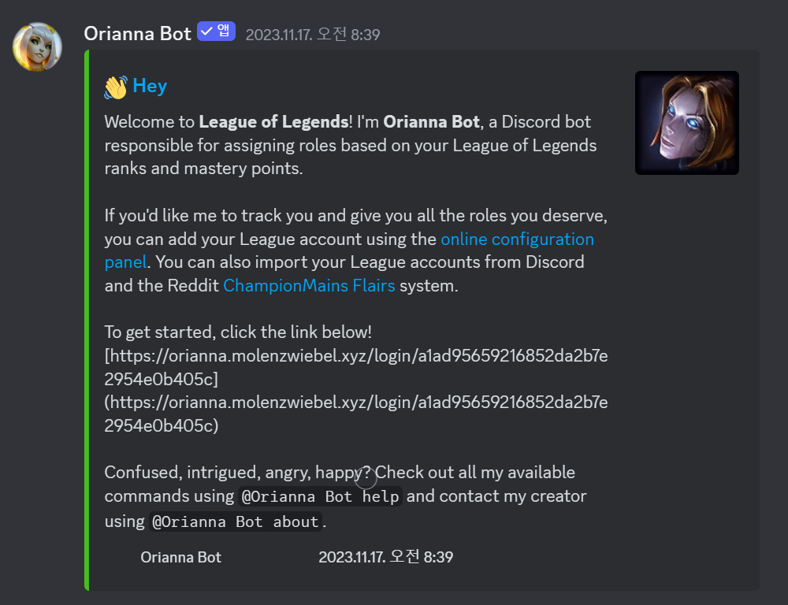
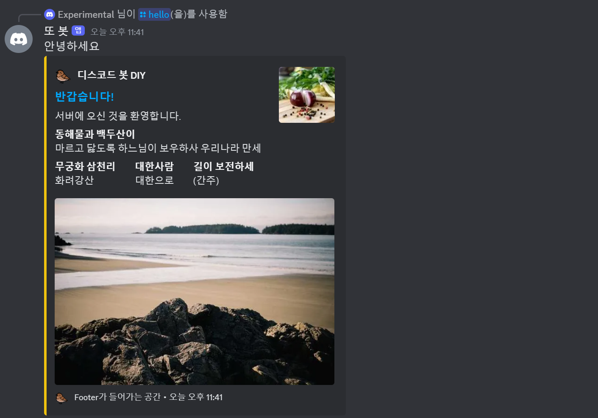
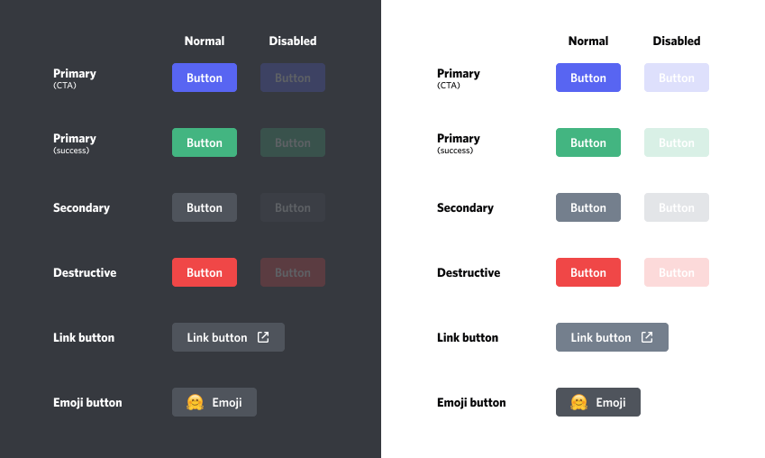

> 이 글에서 다루는 내용
> - Embed 활용해서 메시지 출력하기
> - 버튼과 드롭다운 메뉴로 입력값 받기
> - Timeout 된 객체 비활성화시키기
> - Timeout에 면역인 객체 생성하기 

## 봇의 사용성 높이기

지금까지 만든 기능들은 글로만 메시지를 뱉어내고 글로만 입력을 받는 **Text-based UI**에 불과하다. 물론 디스코드 인터페이스 자체에 여러 종류의 GUI가 있지만, 내 봇과 사용자 간의 입력과 출력을 담당하는 건 밋밋한 텍스트뿐이다. 이 글에서는 봇의 사용성을 높이기 위해 메시지를 꾸미고, 타이핑 없이 봇과 상호 작용을 할 수 있는 방법들에 대해 다룰 것이다.  

### 1. Embed로 메시지 보내기

디스코드를 좀 써봤다면 링크를 보내거나 봇과 상호 작용을 할 때 창을 띄운 것처럼 상자 안에 글과 사진 등이 들어가 있는 메시지를 본 적이 있을 것이다. 그런 형태의 메시지가 바로 **Embed**이다.



위의 이미지처럼 Embed는 박스와 색깔 테두리가 존재해서 일반 메시지보다 시인성이 좋다. 내용에는 텍스트는 물론, **이미지** 등을 넣을 수 있다. 다만 봇이 보내는 rich Embed의 영상 정보는 임의로 설정하는 필드가 아니며, 일반적인 영상 첨부는 파일이나 링크로 처리한다. 일반 사용자들의 채팅은 주로 단순한 글이기 때문에 Embed를 활용하면 채팅과 봇의 출력 메시지를 구분 지어 보기 편하다. Embed에 들어갈 수 있는 요소들을 아래 표에 정리해 보았다.

| 요소          | 설명                                |
| :------------ | :---------------------------------- |
| `author`      | 최상단에 보일 작성자 정보           |
| `color`       | 테두리 색상                         |
| `description` | 상단 `title` 아래 위치하는 설명     |
| `fields`      | 글자를 구분하는 텍스트 상자         |
| `footer`      | 최하단에 조그맣게 보이는 텍스트     |
| `image`       | 첨부할 사진                         |
| `provider`    | 디스코드 외부 서비스 제공자(불필요) |
| `thumbnail`   | 우측 상단에 보이는 작은 이미지      |
| `timestamp`   | 날짜 및 시간 정보                   |
| `title`       | 상단에 큰 글씨로 보이는 제목        |
| `type`        | Embed의 종류, 기본이 `rich`         |
| `url`         | 첨부할 링크                         |
| `video`       | 첨부할 영상                         |

> Embed의 텍스트 요소들에는 **글자 수 제한**이 있다. 자세한 내용은 [여기](https://discord.com/developers/docs/resources/channel#embed-object-embed-limits)를 참고.
{: .prompt-warning}

`description`은 필수 인자가 아니다. 제목, 설명, 필드, 이미지 등 필요한 요소를 조합하되, 내용이 비어 있는 Embed를 보내지 않도록 하자. [Embed API](https://discordpy.readthedocs.io/en/stable/api.html#discord.Embed)에서 생성 인자를 확인할 수 있다. Embed에 요소들을 추가하는 게 꽤 간편하기 때문에 손쉽게 메시지를 깔쌈하게 만들어 보낼 수 있다. 글의 줄 바꿈 여부, 사진의 크기 같은 것들도 설정할 수 있으므로 여러모로 활용하기 좋은 물건이다.

> discord.py에서의 Embed 사용 관련 내용은 [이곳](https://discordpy.readthedocs.io/en/latest/api.html?#embed)을 참고하면 된다.
{: .prompt-info}


*출처: [b1naryth1ef](https://b1naryth1ef.github.io/disco/bot_tutorial/message_embeds.html)*

구성 요소들이 Embed에서 어디에 위치하는지는 위의 사진에서 확인할 수 있다. 요소들의 위치는 각자의 자리에 **고정**되어 있으며 변경이 불가능하다. 예를 들어 썸네일은 항상 우측 상단에 위치하고 첨부된 이미지는 항상 하단에 나온다. 커스터마이징 측면에서는 조금 아쉽지만, 이 특징 덕분에 모든 Embed는 통일된 모습을 보인다.

일전에 만든 **/hello** Slash Command가 Embed를 출력하도록 코드를 고쳐보자.

```python
from datetime import datetime # timestamp 시간 확인용

@bot.tree.command(name='hello', description="인사를 합니다")
async def hello(interaction: discord.Interaction):
    embed = discord.Embed(
        title="반갑습니다!",
        description="서버에 오신 것을 환영합니다.",
        color=discord.Color.gold(),
        timestamp=datetime.now(),
        url='https://sunwoo-j.github.io/'
    )
    embed.add_field(name="동해물과 백두산이", value="마르고 닳도록 하느님이 보우하사 우리나라 만세", inline=False)

    embed.add_field(name="무궁화 삼천리", value="화려강산", inline=True)
    embed.add_field(name="대한사람", value="대한으로", inline=True)
    embed.add_field(name="길이 보전하세", value="(간주)", inline=True)
    
    file = discord.File('icon.gif')
    
    embed.set_author(name="디스코드 봇 DIY", icon_url='attachment://icon.gif')
    embed.set_thumbnail(url='https://picsum.photos/100/100')
    embed.set_image(url='https://picsum.photos/600/400')
    embed.set_footer(text="Footer가 들어가는 공간", icon_url='attachment://icon.gif')
 
    await interaction.response.send_message("안녕하세요", embed=embed, file=file)
```



추가 가능한 거의 모든 요소를 추가해서 Embed를 만들어 보았다. 가장 먼저 `embed = discord.Embed()`로 Embed를 생성하면서 제목과 설명, 색깔, 시간과 링크를 설정해 주었는데, 보편적으로는 `title`, `description`, `color` 세 가지를 활용한다. 색깔은 **헥스 코드**를 사용하거나 위처럼 [`discord.Color`](https://discordpy.readthedocs.io/en/latest/api.html?highlight=colour#discord.Colour)를 사용하면 된다. 

**Field**는 Embed에서 사용하는 **텍스트 상자**라고 생각하면 되는데, Embed의 `title`과 `description`에 맞먹는 `name`과 `value`를 설정해야 한다. `inline`은 **줄 바꿈 설정**으로, `False`면 줄을 바꾸고 `True`면 줄을 바꾸지 않은 채로 다음 field를 추가한다. 그 때문에 `inline=False`인 첫 field는 줄 하나에 홀로 들어가 있고 `inline=True`인 다음 세 개의 field는 줄 하나를 나눠 쓴다. 단, 설정과 관계없이 Embed의 최대 너비를 벗어나면 자동으로 줄이 바뀐다.

> 테스트에 사용할 이미지가 없거나 원하는 규격의 이미지를 쓰고 싶으면 [이 사이트](https://picsum.photos/)를 활용해도 좋다.
{: .prompt-tip}

그 외의 요소들은 `embed.set_author()`처럼 따로 만들어 주면 된다. 이런 텍스트 요소에도 `url` argument를 추가해 링크를 넣을 수 있다. 이미지는 **로컬 폴더**에 저장된 이미지를 사용하거나 **이미지 URL**을 활용할 수 있다. 로컬에서 불러오는 경우 예시처럼 `send_message()`에서 `file`을 지정해야 한다.

이렇게 설정을 끝마쳤으면 텍스트를 보낼 때 쓰던 `send_message()`에 제작한 `embed`를 argument로 지정해 주면 된다. 예시에서는 원래 메시지인 "안녕하세요"를 함께 썼지만, 텍스트 메시지 없이 Embed만 보낼 수 있다.

### 2. 버튼 추가하기

Embed는 봇의 **출력을 디스플레이**하는 용도로 사용하는 데 특화되어 있고 봇에게 **입력값**을 주는 상호 작용은 불가능하다. 그래서 입력이 필요할 때는 메시지에 **Message Component**라는 UI 요소를 추가로 설정한다. 이 부분은 `discord.py` 라이브러리 중 `discord.ui`가 담당하고 있는데, 버튼과 드롭다운 메뉴 같은 Message Component를 메시지에 첨부하려면 `discord.ui`의 **View**라는 요소를 활용해야 한다.

View를 표시하려면 Embed처럼 `send_message()`에서 argument로 지정해야 한다. View는 Message Component를 배치할 수 있는 줄을 **다섯 줄**씩 보유하고 있는데, 줄마다 드롭다운 메뉴 한 개 혹은 버튼 최대 다섯 개를 배치할 수 있다. 즉, 하나의 View에 담을 수 있는 최대 버튼 개수는 스물다섯 개이다.

```python
class ButtonView(discord.ui.View):
    @discord.ui.button(label="날 눌러요!", style=discord.ButtonStyle.primary, emoji='🙂')
    async def button_response(self, interaction: discord.Interaction, button: discord.ui.Button):
        await interaction.response.send_message("간지러워요!")

@bot.tree.command(name='버튼', description="버튼 실험용 명령어")
async def button(interaction: discord.Interaction):
    await interaction.response.send_message(view=ButtonView())
```

> `discord.ui`는 `discord.py` 2.x에 포함되어 있다. 별도의 `discord-ui` 패키지를 설치하지 말고, `python -m pip show discord.py`로 현재 Python 환경의 설치 상태를 확인하자.
{: .prompt-warning}

누르면 메시지가 나오는 버튼을 만들고 해당 버튼을 채팅창에 첨부하는 명령어를 만들었다. 버튼을 배치할 수 있도록 `discord.ui.View`의 subclass를 생성하고 그 안에서 버튼 객체를 추가한 뒤 `send_message()`의 `view` argument에 생성한 View 객체를 지정했다.


이렇게 버튼을 누르면 `@discord.ui.button` decorator가 붙은 `button_response()` 함수가 호출되며 정해진 메시지가 전송된다. 



Decorator에서 버튼의 색상도 `style`로 정해줄 수 있다. `discord.py`에서는 위 사진에 나온 버튼 색상들을 순서대로 `discord.ButtonStyle.primary`, `.success`, `.secondary`, `.danger`, `.link`로 설정할 수 있다.


버튼에는 기본적으로 180초 이후에 **Timeout**이 적용된다. Timeout 상태에서는 버튼을 눌러도 **상호 작용에 실패**했다는 경고만 전송되고 함수가 실행되지 않는데, **외형**은 바뀌지 않기 때문에 어떤 버튼이 아직 사용 가능한지 헷갈릴 수 있다. 이것을 방지하기 위해 사용이 끝나거나 Timeout 상태로 접어든 버튼은 비활성화해 보겠다. 

```python
class ButtonView(discord.ui.View):
    def __init__(self, timeout):
        super().__init__(timeout=timeout)
        self.message = None
        self.button_pressed = False # 버튼을 눌렀는지 확인

    async def on_timeout(self):
        if not self.button_pressed:
            for child in self.children:
                if isinstance(child, discord.ui.Button):
                    child.disabled = True
                    child.label = "실패!"
                    child.style = discord.ButtonStyle.danger
        await self.message.edit(view=self)
        
    @discord.ui.button(label="10초 안에 누르세요!", style=discord.ButtonStyle.primary)
    async def button_response(self, interaction: discord.Interaction, button: discord.ui.Button):
        self.button_pressed = True
        button.disabled = True
        button.label = "성공!"
        button.style = discord.ButtonStyle.success
        await interaction.response.edit_message(view=self)
        
@bot.tree.command(name='버튼', description="버튼 실험용 명령어")
async def button(interaction: discord.Interaction):
    view = ButtonView(timeout=10.0)
    await interaction.response.send_message(view=view)
    view.message = await interaction.original_response()
```


먼저, `ButtonView` 객체를 생성할 때 몇 초 후에 Timeout을 할지 `timeout` 값을 정해 설정하도록 했고, Timeout 전에 버튼을 눌렀으면 "성공!" 텍스트를 띄우면서 `button.disabled = True`로 버튼을 비활성화한다. 버튼 클릭 없이 10초가 지나 `on_timeout()` 함수가 호출될 때도 상응하는 텍스트와 함께 버튼이 비활성화된다. 비활성화된 버튼은 색상이 흐려지며 누르는 게 불가능하다.

### 3. 드롭다운 메뉴 만들기

디스코드의 **Select Menu**는 우리가 흔히 드롭다운 메뉴라고 부르는 사용자에게 선택지를 주는 방법의 하나다. 버튼과 마찬가지로 View에 추가해서 첨부하는 방식이다.

```python
class SelectView(discord.ui.View):
    @discord.ui.select(
        placeholder="국적을 선택하세요",
        min_values=1, # 골라야 할 최소 갯수
        max_values=1, # 고를 수 있는 최대 갯수
        options=[
            discord.SelectOption(
                label="대한민국",
                description="대한민국 국민입니다.",
                emoji='🇰🇷'
            ),
            discord.SelectOption(
                label="미국",
                description="미국 국민입니다.",
                emoji='🇺🇸'
            ),
            discord.SelectOption(
                label="일본",
                description="일본 국민입니다.",
                emoji='🇯🇵'
            )
        ]
    )
    async def select_response(self, interaction: discord.Interaction, select: discord.ui.Select):
        await interaction.response.send_message(f"{select.values[0]} 국적을 선택하셨습니다.")

@bot.tree.command(name='국적', description="국적을 선택합니다")
async def country(interaction: discord.Interaction):
    await interaction.response.send_message(view=SelectView())
```


아직 선택을 하지 않았을 때는 `placeholder`에 넣은 메시지가 표시된다. 여기서는 사용자가 Select Menu에서 어떤 항목을 골라야 하는지에 대한 정보를 직관적으로 보여주는 것이 좋다. 고를 수 있는 항목은 `discord.SelectOption` 객체 리스트를 만들어 `options` parameter에 추가하면 된다.

`SelectOption` attribute 중 `label`은 제목, `description`은 설명이고, 위에서 국기를 추가한 것처럼 `emoji`로 이모지를 붙일 수도 있다. 이외에도 `value`로 선택 시 전달할 값을 지정할 수 있으며, `default=True`로 설정하면 `placeholder` 대신에 해당 `SelectOption` 항목이 기본으로 보이게 된다.

### 4. Action Row 지정하기

앞서 View마다 Message Component를 담을 수 있는 줄이 다섯 줄 있다고 했는데, 이 줄을 **Action Row**라고 한다. 기본적으로 버튼과 드롭다운 메뉴 같은 요소들이 자동으로 배열이 되는데 `row` parameter를 사용해 0과 4 사이의 값으로 상대적인 줄을 설정할 수 있다.

```python
class ActionRowView(discord.ui.View):
    @discord.ui.button(label="버튼 1", row=0, style=discord.ButtonStyle.primary)
    async def first_button_callback(self, interaction, button):
        await interaction.response.send_message("간지러워요!")

    @discord.ui.button(label="버튼 2", row=0, style=discord.ButtonStyle.primary)
    async def second_button_callback(self, interaction, button):
        await interaction.response.send_message("간지러워요!")
    
    @discord.ui.button(label="버튼 3", row=2, style=discord.ButtonStyle.secondary)
    async def third_button_callback(self, interaction, button):
        await interaction.response.send_message("간지러워요!")
    
    @discord.ui.select(
        placeholder="저는 드롭다운 메뉴에요",
        row=1,
        options=[
            discord.SelectOption(label="1"),
            discord.SelectOption(label="2"),
            discord.SelectOption(label="3")
        ]
    )
    async def select_callback(self, interaction, select):
        await interaction.response.send_message(f"숫자 {select.values[0]}번을 골랐어요.")
        
@bot.tree.command(name='액션', description="Action Row 데모를 보여줍니다")
async def country(interaction: discord.Interaction):
    view = ActionRowView()
    await interaction.response.send_message(view=view)
```


`row=0`으로 설정된 버튼 두 개는 같은 줄에 배치됐고 `row=2`로 설정된 버튼 하나는 다른 줄에 배치됐다. Select Menu는 `row=1`로 설정되었기 때문에 `row=0`과 `row=2` 사이에 배치됐다. 줄 순서는 절대적이 아니라 **상대적**이기 때문에 `row=1`이라고 두 번째 줄에 나타나는 것은 아니다. 단순히 값이 더 크면 더 아래에 배치되는 것일 뿐이다. 

같은 줄의 버튼과 버튼 사이를 띄우거나 줄과 줄 사이에 공간을 두는 것은 불가능하다. 위에 만든 `버튼3`의 `row` 값을 3이나 4로 바꿔도 사이에 다른 객체가 없는 한 배치는 **변동이 없다**. 더불어 한 줄에 다섯 칸이 넘어가게 객체를 할당하면 오류가 발생한다.

### 5. 영속적인 View 생성하기

일반 메시지의 View는 `timeout=None`이면 시간 제한이 없다. 15분 제한은 timeout을 지정하지 않은 ephemeral 메시지의 View에 적용되는 별도 규칙이다. 봇이 오프라인이면 콜백을 처리할 수 없으며, 재시작 후에도 작동시키려면 영속 View를 등록해야 한다. [View 공식 문서](https://discordpy.readthedocs.io/en/stable/interactions/api.html#discord.ui.View)를 참고하자. 메시지로 보내진 View는 채널에 그대로 남아있지만, 봇의 연결이 끊겼다 돌아오더라도 상호 작용을 할 수는 없다. 자동 역할 지정 기능처럼 **항시 작동**이 필요한 기능에서 View를 사용한다면 이 점은 굉장히 치명적이다. 하지만 다행히도 우리에게는 해결법이 있다. View에 **영속성(Persistency)**을 부여하면 된다.

위에서 만들었던 `SelectView`를 영속적으로 만들어보자.

```python
class SelectView(discord.ui.View):
    def __init__(self):
        super().__init__(timeout=None) # Timeout 없애기
        self.message = None
        
    @discord.ui.select(
        custom_id='select_view', # custom_id 지정
        placeholder="국적을 선택하세요",
        options=[discord.SelectOption(label="대한민국"), discord.SelectOption(label="미국"), discord.SelectOption(label="일본")]
    )
    async def select_response(self, interaction: discord.Interaction, select: discord.ui.Select):
        await interaction.response.send_message(f"{select.values[0]} 국적을 선택하셨습니다.")

@bot.tree.command(name='국적', description="국적을 선택합니다")
async def country(interaction: discord.Interaction):
    view = SelectView()
    await interaction.response.send_message(view=view)
```

먼저, `timeout=None`으로 Timeout 상태가 되지 않도록 만들어 주고 객체에 `custom_id`를 지정해야 한다.

```python
@bot.event
async def on_ready():
    bot.add_view(SelectView()) # 해당 View를 영속적인 객체로 지정한다
    guild = discord.utils.find(lambda g: g.id == GUILD, bot.guilds)
    print(
        f"{bot.user}(으)로 접속했습니다.\n"
        f"접속 길드: {guild.name} (ID: {guild.id})"
    )
```

다음으로 `on_ready()`에 `bot.add_view()`로 `SelectView`를 추가하면 모든 준비는 끝났다.


봇을 멈췄다가 다시 실행한 뒤 Select Menu를 사용해 보았다. 영속성이 적용되지 않은 View는 위처럼 callback에 실패하지만, 아래의 영속적인 View는 정상적으로 작동한다.

UI를 추가하니 봇이 더욱 풍부해지는 느낌이지만 요소가 추가되어 갈수록 우리의 코드가 지저분해지고 있다. 이 문제를 해결하기 위해 다음은 기능을 분리해 관리할 수 있는 Cog에 대해 알아볼 것이다. 

## 부록

### i. 전체 코드
<details>
<summary>코드 보기</summary>
<div markdown="1">

``` python
# bot.py
import os, discord
from discord import app_commands
from discord.ext import commands
from dotenv import load_dotenv
from datetime import datetime

load_dotenv()
TOKEN = os.getenv('BOT_TOKEN')
GUILD = int(os.getenv('GUILD_ID'))
CHANNEL = int(os.getenv('CHANNEL_ID'))
ADMIN = int(os.getenv('ADMIN_ID'))
welcome_channel = {GUILD:CHANNEL} # 길드별 환영 메시지 전송 채널

intents = discord.Intents.all()

bot = commands.Bot(command_prefix='$', intents=intents)

@bot.event
async def on_ready():
    bot.add_view(SelectView())
    guild = discord.utils.find(lambda g: g.id == GUILD, bot.guilds)
    print(
        f"{bot.user}(으)로 접속했습니다.\n"
        f"접속 길드: {guild.name} (ID: {guild.id})"
    )

@bot.event
async def setup_hook():
    await bot.tree.sync() # tree 동기화
    
@bot.event
async def on_member_join(member):
    guild_id = welcome_channel.get(member.guild.id, None)
    if guild_id is not None:
        channel = bot.get_channel(guild_id)
        await channel.send(f"{member.display_name}님이 서버에 참가하셨습니다.")

@bot.tree.command(name='hello', description="인사를 합니다")
async def hello(interaction: discord.Interaction):
    embed = discord.Embed(
        title=":raised_hands: 반갑습니다!",
        description="서버에 오신 것을 환영합니다.",
        color=discord.Color.gold(),
        timestamp=datetime.now(),
        url='https://sunwoo-j.github.io/'
    )
    embed.add_field(name="동해물과 백두산이", value="마르고 닳도록 하느님이 보우하사 우리나라 만세", inline=False)

    embed.add_field(name="무궁화 삼천리", value="화려강산", inline=True)
    embed.add_field(name="대한사람", value="대한으로", inline=True)
    embed.add_field(name="길이 보전하세", value="(간주)", inline=True)
    
    file = discord.File('icon.gif')
    
    embed.set_author(name="디스코드 봇 DIY", icon_url='attachment://icon.gif')
    embed.set_thumbnail(url='https://picsum.photos/100/100')
    embed.set_field_at
    embed.set_image(url='https://picsum.photos/600/400')
    embed.set_footer(text="Footer가 들어가는 공간", icon_url='attachment://icon.gif')

    await interaction.response.send_message("안녕하세요", embed=embed, file=file)

class ButtonView(discord.ui.View):
    def __init__(self, timeout):
        super().__init__(timeout=timeout)
        self.message = None
        self.button_pressed = False

    async def on_timeout(self):
        if not self.button_pressed:
            for child in self.children:
                if isinstance(child, discord.ui.Button):
                    child.disabled = True
                    child.label = "실패!"
                    child.style = discord.ButtonStyle.danger
        await self.message.edit(view=self)
        
    @discord.ui.button(label="10초 안에 누르세요!", style=discord.ButtonStyle.primary)
    async def button_response(self, interaction: discord.Interaction, button: discord.ui.Button):
        self.button_pressed = True
        button.disabled = True
        button.label = "성공!"
        button.style = discord.ButtonStyle.success
        await interaction.response.edit_message(view=self)
        
@bot.tree.command(name='버튼', description="버튼 실험용 명령어")
async def button(interaction: discord.Interaction):
    view = ButtonView(timeout=10.0)
    await interaction.response.send_message(view=view)
    view.message = await interaction.original_response()
    
class SelectView(discord.ui.View):
    def __init__(self):
        super().__init__(timeout=None)
        self.message = None
        
    @discord.ui.select(
        custom_id='select_view',
        placeholder="국적을 선택하세요",
        min_values=1, # 골라야 할 최소 갯수
        max_values=1, # 고를 수 있는 최대 갯수
        options=[
            discord.SelectOption(
                label="대한민국",
                description="대한민국 국민입니다.",
                emoji='🇰🇷'
            ),
            discord.SelectOption(
                label="미국",
                description="미국 국민입니다.",
                emoji='🇺🇸'
            ),
            discord.SelectOption(
                label="일본",
                description="일본 국민입니다.",
                emoji='🇯🇵'
            )
        ]
    )
    async def select_response(self, interaction: discord.Interaction, select: discord.ui.Select):
        await interaction.response.edit_message(content=f"{select.values[0]} 국적을 선택하셨습니다.")

@bot.tree.command(name='국적', description="국적을 선택합니다")
async def country(interaction: discord.Interaction):
    view = SelectView()
    await interaction.response.send_message(view=view)
    
class ActionRowView(discord.ui.View):
    @discord.ui.button(label="버튼 1", row=0, style=discord.ButtonStyle.primary)
    async def first_button_callback(self, interaction, button):
        await interaction.response.send_message("간지러워요!")

    @discord.ui.button(label="버튼 2", row=0, style=discord.ButtonStyle.primary)
    async def second_button_callback(self, interaction, button):
        await interaction.response.send_message("간지러워요!")
    
    @discord.ui.button(label="버튼 3", row=2, style=discord.ButtonStyle.secondary)
    async def third_button_callback(self, interaction, button):
        await interaction.response.send_message("간지러워요!")
    
    @discord.ui.select(
        placeholder="저는 드롭다운 메뉴에요",
        row=1,
        options=[
            discord.SelectOption(label="1"),
            discord.SelectOption(label="2"),
            discord.SelectOption(label="3")
        ]
    )
    async def select_callback(self, interaction, select):
        await interaction.response.send_message(f"숫자 {select.values[0]}번을 골랐어요.")
        
@bot.tree.command(name='액션', description="Action Row 데모를 보여줍니다")
async def country(interaction: discord.Interaction):
    view = ActionRowView()
    await interaction.response.send_message(view=view)

@bot.tree.command(name='곱하기', description="숫자 두 개를 곱합니다")
@app_commands.describe(정수1="첫 번째 정수", 정수2="두 번째 정수")
async def multiply(interaction: discord.Interaction, 정수1: int, 정수2: int):
    product = 정수1 * 정수2
    await interaction.response.send_message(f"결과는 {product}입니다.")

@bot.tree.command(name='참가일', description="멤버의 서버 참가 날짜를 알려줍니다")
@app_commands.describe(member="조회할 멤버")
async def joined(interaction: discord.Interaction, member: discord.Member):
    join_date = member.joined_at.strftime("%Y-%m-%d")
    await interaction.response.send_message(f"{member.display_name}님은 {join_date}에 서버에 참가했습니다.")

@bot.tree.context_menu(name="참가일")
async def joined_user_menu(interaction: discord.Interaction, member: discord.Member):
    join_date = member.joined_at.strftime("%Y-%m-%d")
    await interaction.response.send_message(f"{member.display_name}님은 {join_date}에 서버에 참가했습니다.")
    
@bot.tree.context_menu(name="글자수")
async def character_count(interaction: discord.Interaction, message: discord.Message):
    characters = len(message.content)
    characters_no_space = len(message.content.replace(' ', ''))
    await interaction.response.send_message(f"공백 포함 {characters}자, 공백 제외 {characters_no_space}자")

bot.run(TOKEN)
```
</div>
</details>

### ii. 폴더 구조

```tree
📦Discord Bot
 ┣ 📂cogs
 ┃ ┣ 📜interface.py
 ┃ ┗ 📜welcome.py
 ┣ 📜.env
 ┣ 📜bot.py
 ┣ 📜icon.gif
 ┗ 📜thumbnail.png
```

### iii. 깃허브 리포지토리

<https://github.com/sunwoo-j/discord-bot-diy>