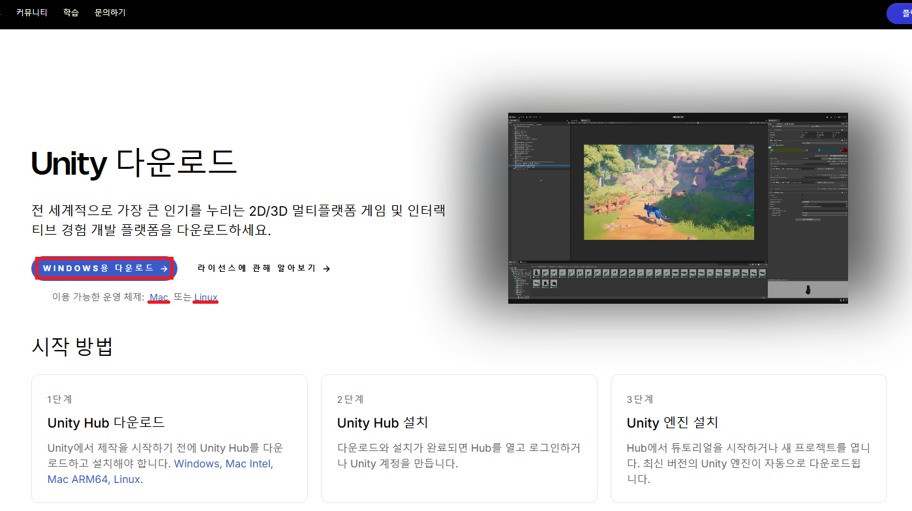
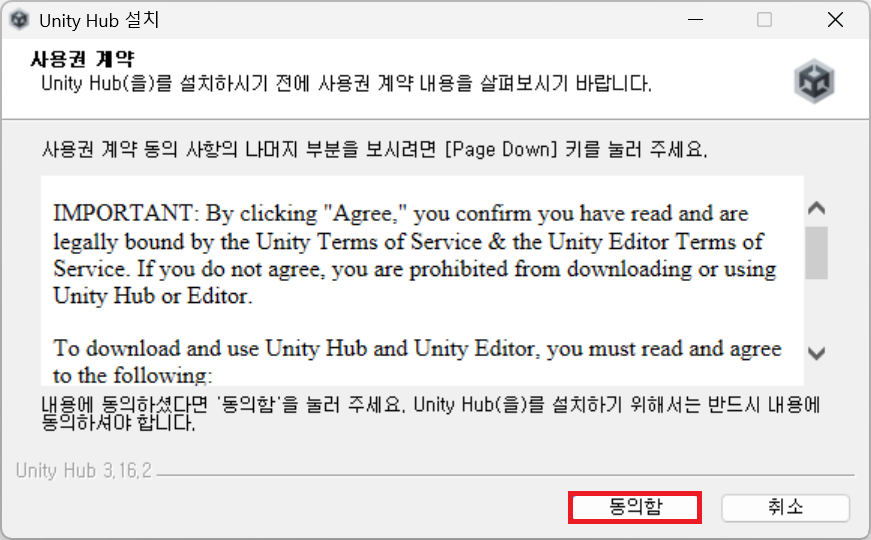
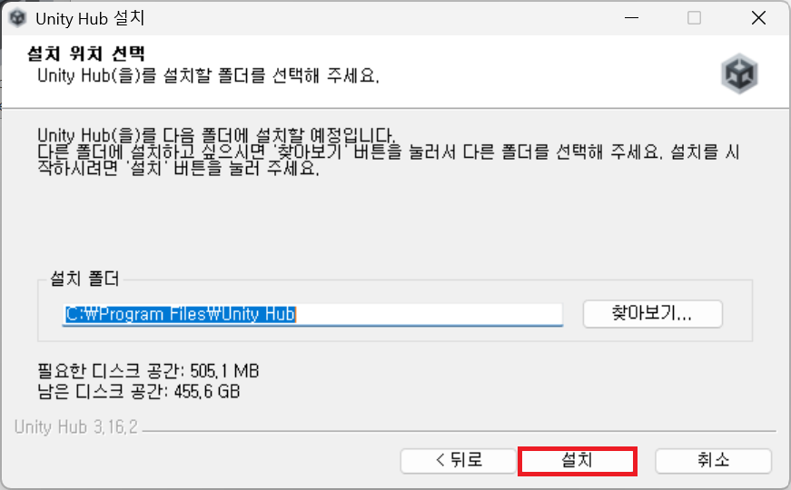
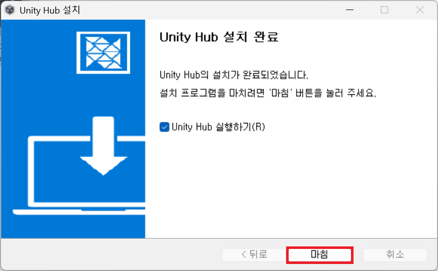
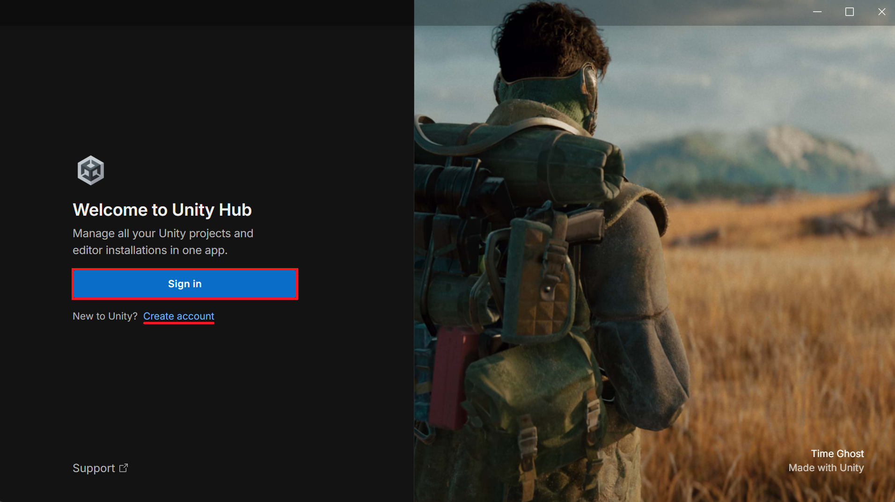
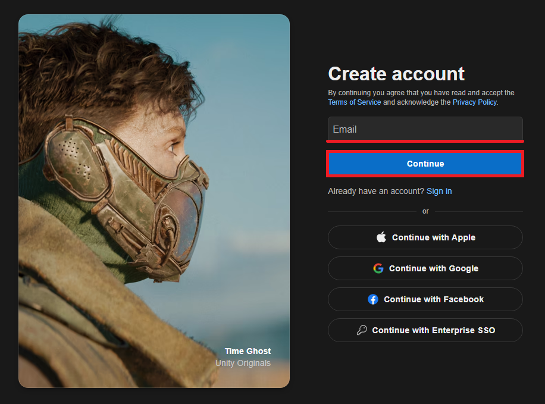
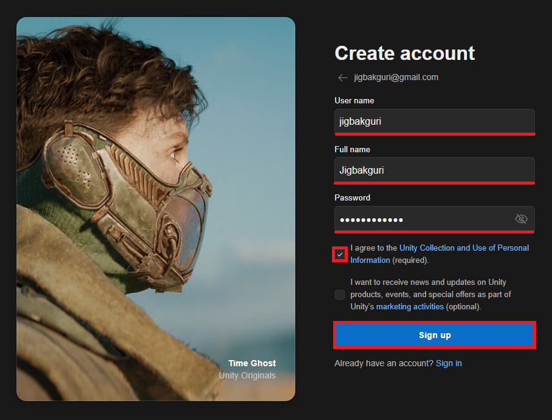
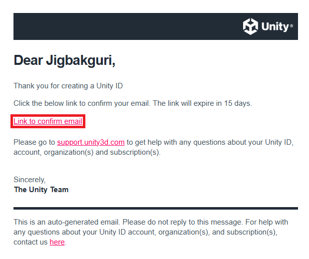
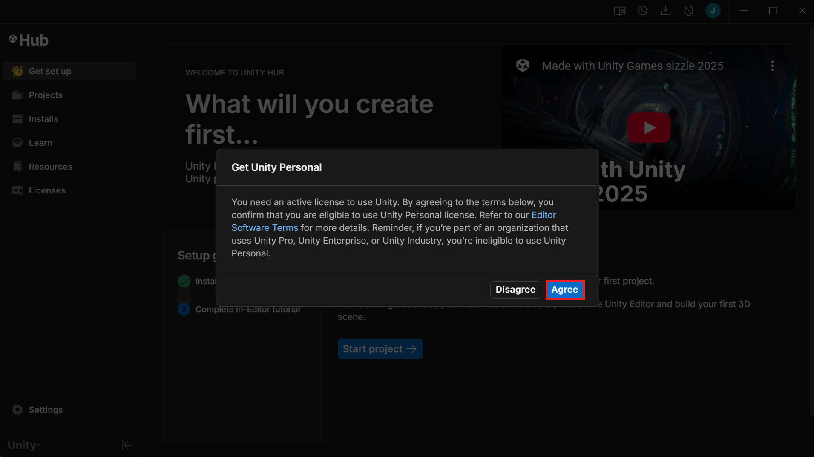
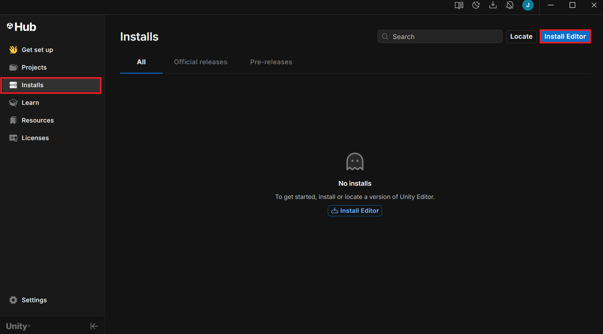

> 이 글에서 다루는 내용
> - 유니티란 무엇인가
> - 유니티 허브 설치하기
> - 새 유니티 계정 생성하기
> - 유니티 에디터 설치하기

## Unity 유니티란?

게임을 만들어보고 싶다는 생각을 했다면 아마 한 번쯤은 **유니티(Unity)**라는 이름을 들어봤을 것이다. 하지만 처음 접하는 사람에게는 이게 정확히 무엇이고 어떻게 돌아가는지 의문부터 생긴다.

*유니티로 제작된 게임을 실행하면 보이는 화면*

유니티는 **게임 엔진(Game Engine)**이다. 게임 엔진은 기본적으로 게임을 만들 때 필요한 기능들을 미리 만들어두고 사용자에게 제공하는 소프트웨어다.

이 기능들의 예를 들자면:

- 화면에 3D 오브젝트를 표현하는 기능
- 물리 충돌 계산
- 애니메이션 재생
- 소리 출력
- 빌드(게임 파일로 변환)

등이 있다. 이런 것들을 하나하나 처음부터 직접 구현하지 않아도 되도록 도와주는 도구가 바로 게임 엔진이다.

### 그래서 왜 유니티를 선택할까?

게임 엔진에는 유니티 말고도 고도, 언리얼 엔진, 게임메이커 등 여러 가지가 있다. 유니티가 전세계적으로 게임 개발자들에게 사랑받는 이유는 여러가지가 있다. 

비교적 배우기 쉬우면서 2D와 3D를 모두 지원하고, 모바일, PC, 콘솔 등 다양한 플랫폼을 지원한다. 그리고 가장 핵심적으로 **자료와 튜토리얼**이 매우 많다. 입문자에게 있어 가장 **접근성이 좋은 엔진**인 셈이다.

유니티로 만든 게임들 또한 매우 많은데, 포켓몬 GO, 원신, 할로우 나이트, 어몽 어스 등 게이머라면 알법한 많은 게임들이 유니티로 제작됐다. 이처럼 유니티는 **규모와 장르에 상관없이** 다양한 게임 제작에 사용된다.

## 유니티 설치 방법

유니티를 사용하기로 마음 먹었다면 이제 직접 설치해 볼 차례다.

### 1. 유니티 허브 설치

**유니티 허브(Unity Hub)**는 유니티 버전들과 프로젝트들을 관리해주는 프로그램이다. 쉽게 말해 유니티 전용 **관리앱**이다.

먼저 [유니티 공식 다운로드 페이지](https://unity.com/kr/download)에서 자신의 운영 체제에 맞게 설치 파일을 다운로드 해주자.

다운로드 받은 파일을 실행하고, 뜨는 창에서 약관에 동의하고 설치를 진행하면 유니티 허브는 간단하게 설치가 완료된다.

 |  | 

### 2. 유니티 계정 생성

유니티 허브를 설치 후 실행하면 아래 같은 창이 반겨준다. 계정이 이미 있다면 <kbd>Sign in</kbd>을 선택해 로그인하면 되고 없다면 <kbd>Create account</kbd>를 클릭하자.

회원가입은 여타 서비스와 비슷하게 이메일 입력 혹은 구글 계정 연동을 통해 진행하면 된다. 여기서 **Full name** 칸에 굳이 실명을 쓸 필요는 없다.

 | 

정보를 모두 입력했다면 회원가입에 사용한 이메일에 들어가 이메일 인증을 완료해야 한다.

가입이 완료된 후 유니티 허브로 돌아가면 이런 팝업 창이 뜰 것이다. **개인 라이센스(Personal License)**를 활성화하라는 건데, 기본적으로 수익이 20만 달러 이하인 개인 및 소규모 스튜디오에게 유니티를 무료로 제공하는 라이센스다. 개인 개발자는 이 라이센스로 충분하다.

추후에 라이센스가 만료되더라도 조건만 충족한다면 계속 연장하여 쓸 수 있다.

### 3. 유니티 에디터 설치

이제 실제 게임을 만드는 환경인 **유니티 에디터(Unity Editor)**를 설치할 차례다. 유니티 허브에서 좌측 <kbd>Installs</kbd> 메뉴를 선택하고 우측 상단의 <kbd>Install Editor</kbd>를 클릭하자.

