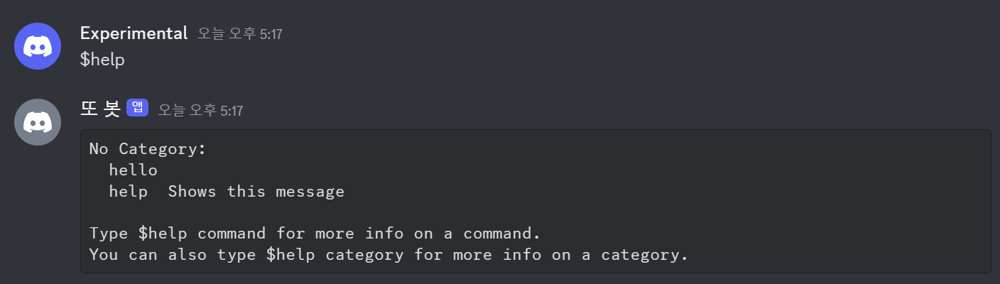
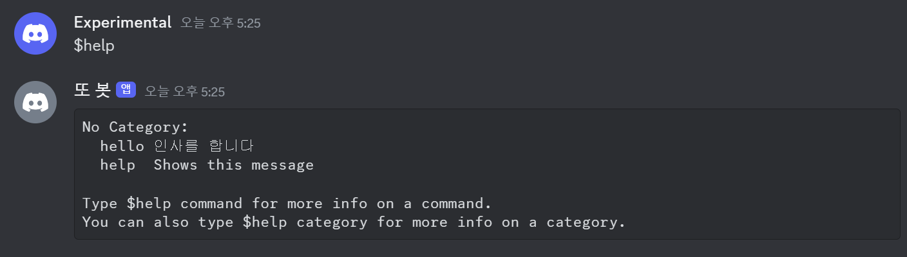

> In this entry
> - Moving from `Client` to `Bot`
> - Creating commands
> - Basic error handling

## Bot and the commands extension

[`Bot`](https://discordpy.readthedocs.io/en/stable/ext/commands/api.html?#bot) is a subclass of `Client`. We could build everything with `Client`, but manually interpreting messages in event handlers becomes tedious. The `discord.ext.commands` extension supplies `Bot` and tools that make adding commands easier.

### 1. Add a command with Bot

```python
from discord.ext import commands

import discord

intents = discord.Intents.default()
intents.message_content = True
bot = commands.Bot(command_prefix='!', intents=intents) # 명령어 인식 기호
```

Import `commands` separately from `discord`. When creating a bot, specify `command_prefix` and the required intents. Here, messages start with `!`, followed by a registered command name.

> You can pass several prefixes, such as `('!', '?')`. An empty prefix allows a registered command name to be used without a prefix.
{: .prompt-info}

A `Command` represents a function invoked through a command. Adding the `@bot.command` decorator registers an asynchronous function. When the name following the prefix matches the decorator’s `name`, that command runs. Here is the previous message handler, followed by its command-based equivalent.

```python
# bot.py 
# 수정 전
import os, discord
from dotenv import load_dotenv

load_dotenv()
TOKEN = os.getenv('BOT_TOKEN')

intents = discord.Intents.all()

client = discord.Client(intents=intents)

@client.event
async def on_ready():
    print(f'{client.user}(으)로 접속했습니다.')

@client.event
async def on_message(message):
    if message.author == client.user:
        return

    if message.content.startswith('$hello'):
        await message.channel.send('Hello!')

client.run(TOKEN)
```

```python
# bot.py 
# 수정 후
import os, discord
from discord.ext import commands
from dotenv import load_dotenv

load_dotenv()
TOKEN = os.getenv('BOT_TOKEN')

intents = discord.Intents.all()

bot = commands.Bot(command_prefix='$', intents=intents)

@bot.event
async def on_ready():
    print(f'{bot.user}(으)로 접속했습니다.')

@bot.command(name='hello')
async def hello(ctx):
    await ctx.send('Hello!')

bot.run(TOKEN)
```

Both examples respond in the same way. The second uses a command instead of defining an `on_message()` handler. With `name='hello'`, the prefix and name combine into `$hello`.

> `ctx` contains the [invocation context](https://discordpy.readthedocs.io/en/latest/ext/commands/commands.html#invocation-context), including who invoked the command and which channel it came from.
{: .prompt-info}



The commands extension also tracks registered commands and supplies a `help` command that lists them automatically.

```python
@bot.command(name='hello', help="인사를 합니다")
```



Add a `help` argument to a command decorator to describe the command. This is a simple way to show users what the bot can do, and one of several conveniences `Bot` adds to `Client`.

### 2. Add parameters

When parsing messages manually, we receive strings and must convert them ourselves. Commands can use parameter annotations to request a conversion.

```python
@bot.command(name='곱하기', help="숫자 두 개를 곱합니다")
async def multiply(ctx, first_int: int, second_int: int):
    product = first_int * second_int
    await ctx.send("결과는 ", product, "입니다.")
```

The `: int` annotations on `first_int` and `second_int` request integer values. Users can still supply invalid input, so error handling remains necessary. Supported converters also include Discord-specific types such as guilds and members.

```python
@bot.command(name='참가일', help="멤버의 서버 참가 날짜를 알려줍니다")
async def joined(ctx, member: discord.Member):
    join_date = member.joined_at.strftime("%Y-%m-%d")
    await ctx.send(f"{member.display_name}님은 {join_date}에 서버에 참가했습니다.")
```

This command displays when a member joined the current guild. Annotating the parameter as `discord.Member` asks the framework to resolve a member object, whose `joined_at` attribute provides the join time.


Other useful member attributes include `display_name`, the name shown in the guild; `name`, the username; and `id`, the stable user identifier. Choose the attribute that matches the task.

### 3. Handle command errors

```python
@multiply.error
async def multiply_error(ctx, error):
    if isinstance(error, commands.BadArgument):
        await ctx.send("오류: 정수 두 개를 입력해 주세요.")
```

Another advantage of the extension is a dedicated error handler for a command. This example handles `BadArgument`, which can occur when an argument cannot be converted to the requested type.

> The [exception reference](https://discordpy.readthedocs.io/en/latest/ext/commands/api.html?error#exceptions) lists other command errors.
{: .prompt-info}


The bot now gives different responses for valid integer input and invalid input. Another approach is to constrain input through the interface, such as by providing choices. We will explore that with another command system later.

## Appendix

### i. Complete code

<details>
<summary>Show code</summary>
<div markdown="1">

```python
# bot.py
import os, discord
from discord.ext import commands
from dotenv import load_dotenv

load_dotenv()
TOKEN = os.getenv('BOT_TOKEN')

intents = discord.Intents.all()

bot = commands.Bot(command_prefix='$', intents=intents)

@bot.event
async def on_ready():
    print(f'{bot.user}(으)로 접속했습니다.')

@bot.command(name='hello', help="인사를 합니다")
async def hello(ctx):
    await ctx.send("Hello!")

@bot.command(name='곱하기', help="숫자 두 개를 곱합니다")
async def multiply(ctx, first_int: int, second_int: int):
    await ctx.send(f"결과는 {product}입니다.")
        
@bot.command(name='참가일', help="멤버의 서버 참가 날짜를 알려줍니다")
async def joined(ctx, member: discord.Member):
    join_date = member.joined_at.strftime("%Y-%m-%d")
    await ctx.send(f"{member.display_name}님은 {join_date}에 서버에 참가했습니다.")

@multiply.error
async def multiply_error(ctx, error):
    if isinstance(error, commands.BadArgument):
        await ctx.send("오류: 정수 두 개를 입력해 주세요.")

bot.run(TOKEN)
```

</div>
</details>

### ii. Folder structure

```tree
📦Discord Bot
 ┣ 📜.env
 ┗ 📜bot.py
```

### iii. GitHub repository

<https://github.com/sunwoo-j/discord-bot-diy>
