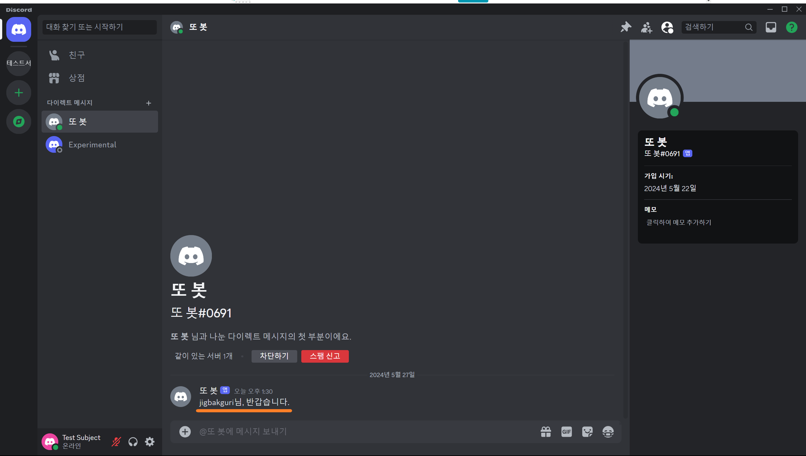
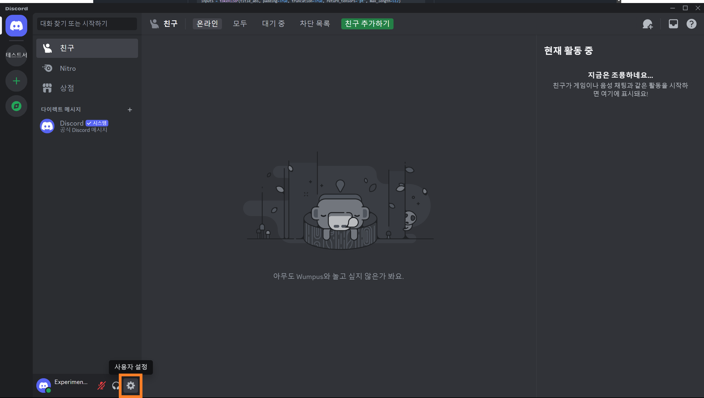
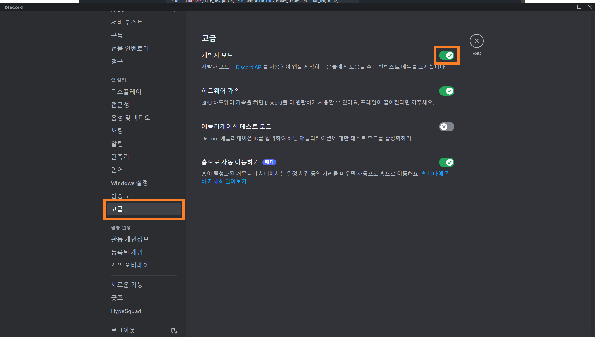
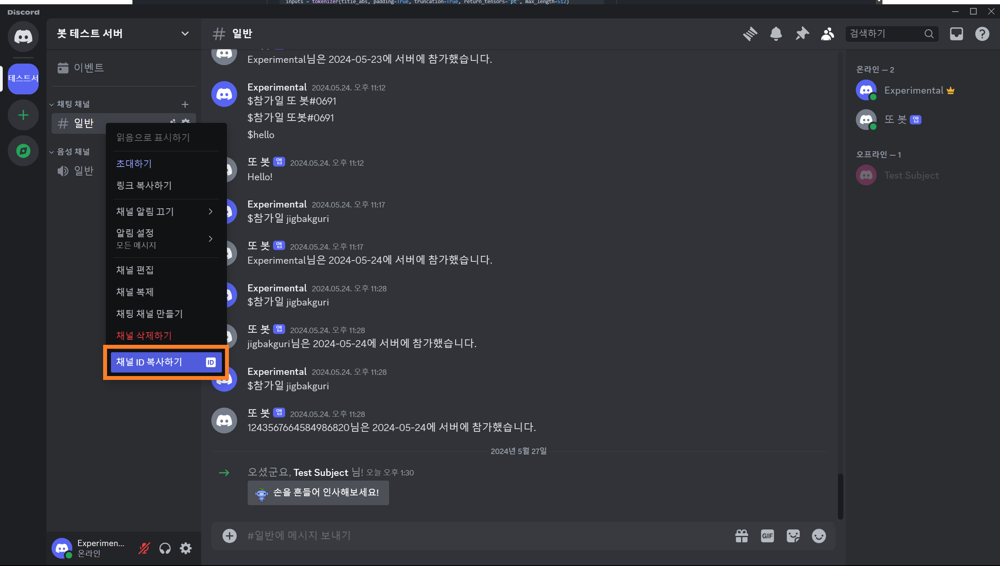
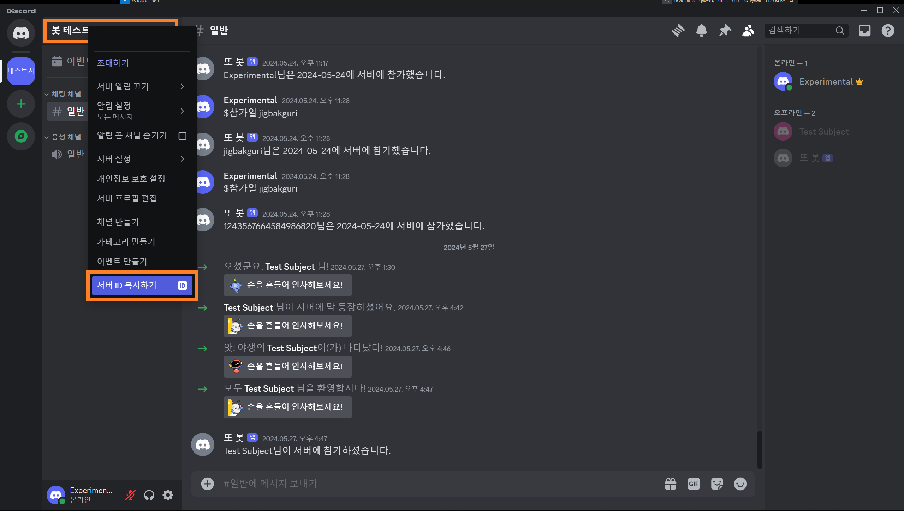

> In this entry
> - Understanding event categories
> - Sending welcome DMs to new members
> - Using guild and channel IDs

## Event categories

So far we have used only `on_ready()` and `on_message()`, but Discord exposes many other events. Let us look at how to find the right one for a feature.

> Event handlers must be coroutines defined with `async def`.
{: .prompt-warning}

The following is an overview of the categories in the [`discord.py` event reference](https://discordpy.readthedocs.io/en/latest/api.html?#discord-api-events). Navigate to the relevant event to check its exact intent requirements; a category can contain events with different requirements.

| Category | Purpose | Related intents to check |
| --- | --- | --- |
| App commands | Application-command events | See the individual event |
| AutoMod | Automatic moderation | `auto_moderation_configuration` |
| Channels | Text and voice channels | `guilds`, `messages`, `typing` |
| Connection | Client connection lifecycle | See the individual event |
| Debug | Errors and WebSocket diagnostics | See the individual event |
| Entitlements | Premium app services | See the individual event |
| Gateway | Gateway connection readiness | See the individual event |
| Guilds | Guild changes | `guilds`, `emojis_and_stickers`, `moderation`, `invites` |
| Integration | External integrations | `integrations`, `webhooks` |
| Interactions | User interactions | See the individual event |
| Members | Guild members | `members`, `moderation`, `presences` |
| Message | Messages | `messages` |
| Polls | Polls | `message_content`, `polls` |
| Reactions | Message reactions | `reactions`, `members` |
| Roles | Guild roles | `guilds` |
| Scheduled Events | Scheduled guild events | `guild_scheduled_events` |
| Stages | Stage channels | See the individual event |
| Threads | Guild threads | `guilds`, `members` |
| Voice | Voice state changes | `voice_states` |

This entry focuses on a new member joining a guild. Looking under **Members** in the reference leads us to `on_member_join()`.

## Welcoming new members

When someone joins a guild, we want to help them settle in and understand the rules. A notice alone cannot force someone to read it. Community guilds can use Rules Screening, but that requires community features to be enabled.

Even a brief introduction can help newcomers participate. Joining an established group without context is difficult, which is why many guilds use bots to send rules and basic information.

Features such as reaction roles can come later. For now, we will send a welcome message.

### 1. Send a welcome DM

Discord can send its own system join notification. For a custom message or onboarding process, use `on_member_join()`.

```python
@bot.event
async def on_member_join(member):
    await member.send(f"{member.name}님, 반갑습니다.")
```

The handler receives the newly joined `member`. Calling `member.send()` sends that member a direct message.

> Enable `intents.members = True` in code and **Server Members Intent** in the Developer Portal to receive this event.
{: .prompt-warning}



Our test account received a DM immediately after joining. The same approach can deliver rules or introductory information. However, `member.send()` can raise `discord.Forbidden` if DMs are blocked, so handle that exception. Also check whether `get_channel()` returns `None` and whether the bot has permission to send to the chosen channel. A guild channel can be a more reliable place for the welcome message.

### 2. Send a welcome message to a guild channel

When handling a command, `ctx` tells us which channel the command came from. The member-join event receives a member, without a destination channel, so we need to specify the **channel ID** ourselves.



Open **User Settings** using the gear icon.



Under **Advanced**, enable **Developer Mode**.



Return to the guild, right-click the destination channel, and choose **Copy Channel ID**. Then use that ID in the code.

```python
@bot.event
async def on_member_join(member):
    channel = bot.get_channel(123456789012345678) # 실제 채널 ID로 교체
    await channel.send(f"{member.display_name}님이 서버에 참가하셨습니다.")
```

A channel ID is an integer, unlike the token string. Replace the example number with the actual channel ID.


When the test account rejoins, the bot sends a message to that channel. Hard-coding one channel works for this small test, but a configurable destination would be better for a guild with several channels.

There is another problem: a bot can belong to multiple guilds. Without checking which guild the member joined, every join event can send its welcome message to this same channel.


I created a second guild and added both the bot and test account. The welcome message still appeared in the original guild. Let us fix that.

### 3. Identify the guild

Guilds have unique IDs just like channels. Developer Mode also makes these available in Discord’s interface.



Copy the test guild’s ID from its context menu. Add `GUILD_ID` and `CHANNEL_ID` to `.env`, using the original test guild and its welcome channel.

```text
# .env
BOT_TOKEN={봇 토큰}
GUILD_ID={길드 ID}
CHANNEL_ID={채널 ID}
```

```python
load_dotenv()
TOKEN = os.getenv('BOT_TOKEN')
GUILD = int(os.getenv('GUILD_ID'))
CHANNEL = int(os.getenv('CHANNEL_ID'))
```

Environment variables are strings, so convert the guild and channel IDs to integers.

```python
@bot.event
async def on_ready():
    guild = discord.utils.find(lambda g: g.id == GUILD, bot.guilds)
    print(
        f"{bot.user}(으)로 접속했습니다.\n"
        f"접속 길드: {guild.name} (ID: {guild.id})"
    )
```

I also added guild information to `on_ready()`. `discord.utils.find()` searches `bot.guilds` for the ID loaded from `.env`, allowing the log to confirm the connection to the particular guild being tested.

```python
welcome_channel = {GUILD:CHANNEL}
```

The `welcome_channel` dictionary maps each guild ID to its destination channel ID. A dictionary makes it straightforward to add more guilds later.

```python
@bot.event
async def on_member_join(member):
    guild_id = welcome_channel.get(member.guild.id, None)
    if guild_id is not None:
        channel = bot.get_channel(guild_id)
        await channel.send(f"{member.display_name}님이 서버에 참가하셨습니다.")
```

The join handler reads the member’s guild ID, looks up its channel, and sends the welcome message there. Each guild can now have its own destination.

The IDs are still configured manually in `.env`. Eventually, an administrator could set the destination with a command. Persisting those settings for multiple guilds will require a database, so we will return to this later. Next, we will explore other ways for users to interact with the bot.

## Appendix

### i. Complete code

<details>
<summary>Show code</summary>
<div markdown="1">

```python
# bot.py
import os, discord
from discord.ext import commands
from dotenv import load_dotenv

load_dotenv()
TOKEN = os.getenv('BOT_TOKEN')
GUILD = int(os.getenv('GUILD_ID'))
CHANNEL = int(os.getenv('CHANNEL_ID'))
welcome_channel = {GUILD:CHANNEL} # 길드별 환영 메시지 전송 채널

intents = discord.Intents.all()

bot = commands.Bot(command_prefix='$', intents=intents)

@bot.event
async def on_ready():
    guild = discord.utils.find(lambda g: g.id == GUILD, bot.guilds)
    print(
        f"{bot.user}(으)로 접속했습니다.\n"
        f"접속 길드: {guild.name} (ID: {guild.id})"
    )
    
@bot.event
async def on_member_join(member):
    guild_id = welcome_channel.get(member.guild.id, None)
    if guild_id is not None:
        channel = bot.get_channel(guild_id)
        await channel.send(f"{member.display_name}님이 서버에 참가하셨습니다.")

@bot.command(name='hello', help="인사를 합니다")
async def hello(ctx):
    await ctx.send("Hello!")

@bot.command(name='곱하기', help="숫자 두 개를 곱합니다")
async def multiply(ctx, first_int: int, second_int: int):
    product = first_int * second_int
    await ctx.send(f"결과는 {product}입니다.")

@multiply.error
async def multiply_error(ctx, error):
    if isinstance(error, commands.BadArgument):
        await ctx.send("오류: 정수 두 개를 입력해 주세요.")
        
@bot.command(name='참가일', help="멤버의 서버 참가 날짜를 알려줍니다")
async def joined(ctx, member: discord.Member):
    join_date = member.joined_at.strftime("%Y-%m-%d")
    await ctx.send(f"{member.display_name}님은 {join_date}에 서버에 참가했습니다.")

bot.run(TOKEN)
```

</div>
</details>

### ii. Folder structure

```tree
📦Discord Bot
 ┣ 📜.env
 ┗ 📜bot.py
```

### iii. GitHub repository

<https://github.com/sunwoo-j/discord-bot-diy>
