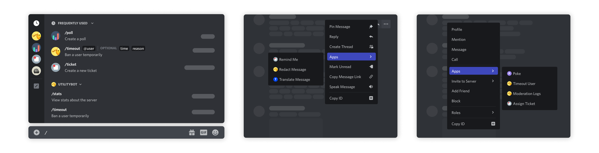
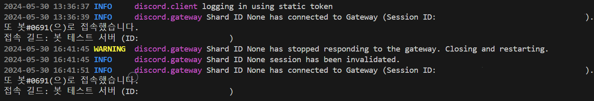
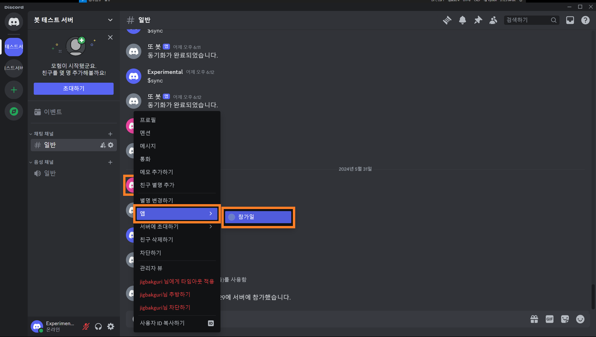
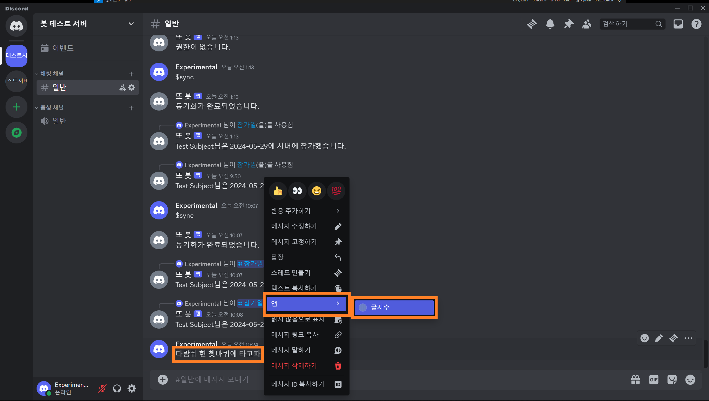

> In this entry
> - Understanding application commands
> - Setting up slash commands
> - Using context menus instead of typed commands

## Application commands

**Application commands** are Discord’s native ways to invoke app functionality through its interface. This entry covers slash, message, and user commands.

> See Discord’s [application-command guide](https://discord.com/developers/docs/tutorials/upgrading-to-application-commands) for further details.
{: .prompt-info}



The image shows a **slash command**, **message command**, and **user command**, from left to right.

- **Slash commands:** Type `/` in the message box and choose a command. Discord also provides app entry points in its interface.
- **Message commands:** Right-click a message, or open its **…** menu, then choose an action under **Apps**.
- **User commands:** Right-click a member’s name or avatar and choose an action under **Apps**.

Earlier, we configured our own `command_prefix` with `discord.ext.commands.Bot`. Slash commands consistently begin with `/`, and Discord supplies command discovery and parameter descriptions through its interface.

### 1. Convert existing commands to slash commands

The key concept is `tree`. Replace `@bot.command` with `@bot.tree.command` to create a slash command. `Bot.tree` is a `CommandTree`: a local collection of application commands. The decorator adds the command to that collection.

```python
# 수정 전
@bot.command(name='hello', help="인사를 합니다")
async def hello(ctx):
    await ctx.send("Hello!")
```

```python
# 수정 후
@bot.tree.command(name='hello', description="인사를 합니다")
async def hello(interaction: discord.Interaction):
    await interaction.response.send_message("Hello!")
```

The revised `hello` command uses `description` in place of the prefix command’s `help` text, and receives an `interaction` rather than `ctx`.


Typing the first few characters brings up **/hello**, along with its description. Commands with parameters also become easier to use.

```python
# 수정 전
@bot.command(name='참가일', help="멤버의 서버 참가 날짜를 알려줍니다")
async def joined(ctx, member: discord.Member):
    join_date = member.joined_at.strftime("%Y-%m-%d")
    await ctx.send(f"{member.display_name}님은 {join_date}에 서버에 참가했습니다.")
```

```python
# 수정 후
from discord import app_commands # app_commands 불러오기

@bot.tree.command(name='참가일', description="멤버의 서버 참가 날짜를 알려줍니다")
@app_commands.describe(멤버="조회할 멤버")
async def joined(interaction: discord.Interaction, 멤버: discord.Member):
    join_date = 멤버.joined_at.strftime("%Y-%m-%d")
    await interaction.response.send_message(f"{멤버.display_name}님은 {join_date}에 서버에 참가했습니다.")
```

Import `app_commands` and add `@app_commands.describe()` to describe each parameter. Here it explains `member`.


Because the parameter is annotated as `discord.Member`, Discord offers a member picker rather than requiring the user to type a name manually. This also constrains the supplied value, though application-specific validation and error handling are still necessary.

### 2. Synchronize commands

Adding a command locally does not immediately make it visible in Discord. Synchronize the `CommandTree` with `bot.tree.sync()` to publish its current definitions.

```python
@bot.event
async def setup_hook():
    await bot.tree.sync()
```

Calling `sync()` from `setup_hook()` applies command changes during startup. Refreshing the Discord interface may help display them, although propagation can take time.

`setup_hook()` is an initialization hook called after login and before connecting to the WebSocket. It differs from `on_ready()`, which can run again after reconnecting. The setup hook runs once during the client’s login sequence.



The terminal shows `on_ready()` running after reconnection. Use `setup_hook()` for initialization intended to happen once per startup.

If you prefer manual synchronization, create a command instead.

```python
ADMIN = int(os.getenv('ADMIN_ID'))

@bot.command(name="sync")
async def sync(ctx):
    if ctx.author.id == ADMIN:
        await bot.tree.sync()
        await ctx.send("동기화가 완료되었습니다.")
    else:
        await ctx.send("권한이 없습니다.")
```

This example checks whether the caller matches the administrator configured in `.env`. It uses a prefix command so it does not appear in the slash-command list. The identity check is what restricts access; hiding it from a list does not provide authorization.


Synchronization succeeds for the administrator and is rejected for other users. We will explore permissions and role-based access in more detail later.

### 3. Use context menus

Context menus define message and user commands. Use `@bot.tree.context_menu` rather than the slash-command decorator. First, let us reuse the idea of displaying a member’s join date.

```python
# Slash Command
@bot.tree.command(name='참가일', description="멤버의 서버 참가 날짜를 알려줍니다")
@app_commands.describe(member="조회할 멤버")
async def joined(interaction: discord.Interaction, member: discord.Member):
    join_date = member.joined_at.strftime("%Y-%m-%d")
    await interaction.response.send_message(f"{member.display_name}님은 {join_date}에 서버에 참가했습니다.")
    
# User Command
@bot.tree.context_menu(name="참가일", description="멤버의 서버 참가 날짜를 알려줍니다")
async def joined_user_menu(interaction: discord.Interaction, member: discord.Member):
    join_date = member.joined_at.strftime("%Y-%m-%d")
    await interaction.response.send_message(f"{member.display_name}님은 {join_date}에 서버에 참가했습니다.")
```

A user command starts with a particular member already selected, so the user does not need to supply that member as a typed argument.



Right-click the member’s avatar, or open the corresponding menu on mobile, and choose the newly added join-date action under **Apps**.


It produces the same result as the slash command. Shared logic can be moved into a separate asynchronous function and reused by both callbacks.

Next, create a message command. The decorator is the same, but its target parameter is annotated as `discord.Message` instead of `discord.Member`.

```python
@bot.tree.context_menu(name="글자수")
async def joined(interaction: discord.Interaction, message: discord.Message):
    characters = len(message.content)
    characters_no_space = len(message.content.replace(' ', ''))
    await interaction.response.send_message(f"공백 포함 {characters}자, 공백 제외 {characters_no_space}자")
```

This simple example uses `message.content` and `len()` to count characters.



Open the target message’s context menu and choose the character-count action under **Apps**.


The response shows counts with and without spaces. We now have all three command types covered here. The output is still plain text, so next we will look at embeds and interactive UI components.

## Appendix

### i. Complete code

<details>
<summary>Show code</summary>
<div markdown="1">

```python
# bot.py
import os, discord
from discord import app_commands
from discord.ext import commands
from dotenv import load_dotenv

load_dotenv()
TOKEN = os.getenv('BOT_TOKEN')
GUILD = int(os.getenv('GUILD_ID'))
CHANNEL = int(os.getenv('CHANNEL_ID'))
ADMIN = int(os.getenv('ADMIN_ID'))
welcome_channel = {GUILD:CHANNEL} # 길드별 환영 메시지 전송 채널

intents = discord.Intents.all()

bot = commands.Bot(command_prefix='$', intents=intents)

@bot.event
async def on_ready():
    guild = discord.utils.find(lambda g: g.id == GUILD, bot.guilds)
    print(
        f"{bot.user}(으)로 접속했습니다.\n"
        f"접속 길드: {guild.name} (ID: {guild.id})"
    )

@bot.event
async def setup_hook():
    await bot.tree.sync() # tree 동기화
    
@bot.event
async def on_member_join(member):
    guild_id = welcome_channel.get(member.guild.id, None)
    if guild_id is not None:
        channel = bot.get_channel(guild_id)
        await channel.send(f"{member.display_name}님이 서버에 참가하셨습니다.")

@bot.tree.command(name='hello', description="인사를 합니다")
async def hello(interaction: discord.Interaction):
    await interaction.response.send_message("Hello!")

@bot.tree.command(name='곱하기', description="숫자 두 개를 곱합니다")
@app_commands.describe(정수1="첫 번째 정수", 정수2="두 번째 정수")
async def multiply(interaction: discord.Interaction, 정수1: int, 정수2: int):
    product = 정수1 * 정수2
    await interaction.response.send_message(f"결과는 {product}입니다.")

@bot.tree.command(name='참가일', description="멤버의 서버 참가 날짜를 알려줍니다")
@app_commands.describe(멤버="조회할 멤버")
async def joined(interaction: discord.Interaction, 멤버: discord.Member):
    join_date = 멤버.joined_at.strftime("%Y-%m-%d")
    await interaction.response.send_message(f"{멤버.display_name}님은 {join_date}에 서버에 참가했습니다.")

@bot.tree.context_menu(name="참가일")
async def joined_user_menu(interaction: discord.Interaction, member: discord.Member):
    join_date = member.joined_at.strftime("%Y-%m-%d")
    await interaction.response.send_message(f"{member.display_name}님은 {join_date}에 서버에 참가했습니다.")
    
@bot.tree.context_menu(name="글자수")
async def character_count(interaction: discord.Interaction, message: discord.Message):
    characters = len(message.content)
    characters_no_space = len(message.content.replace(' ', ''))
    await interaction.response.send_message(f"공백 포함 {characters}자, 공백 제외 {characters_no_space}자")

bot.run(TOKEN)
```

</div>
</details>

### ii. Folder structure

```tree
📦Discord Bot
 ┣ 📜.env
 ┗ 📜bot.py
```

### iii. GitHub repository

<https://github.com/sunwoo-j/discord-bot-diy>
