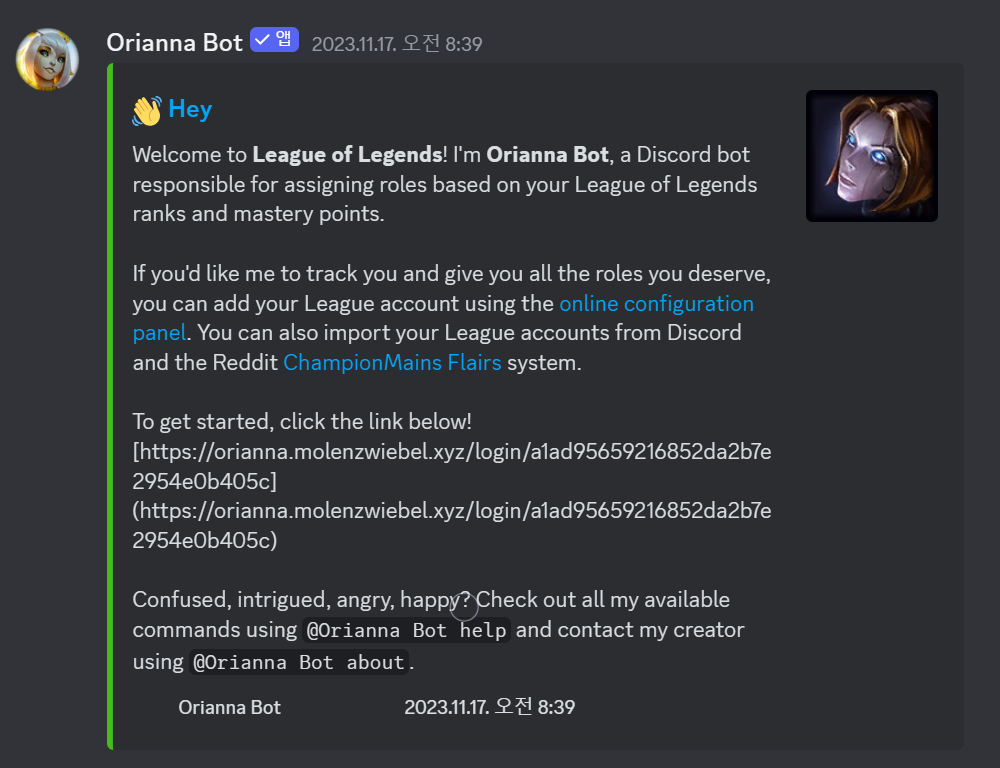
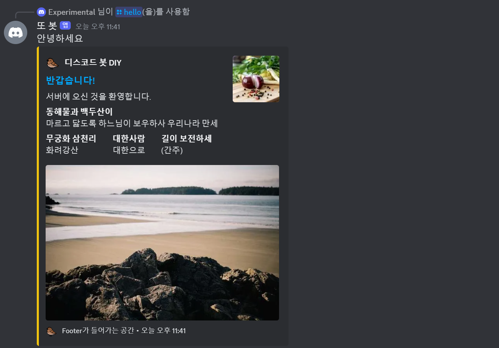
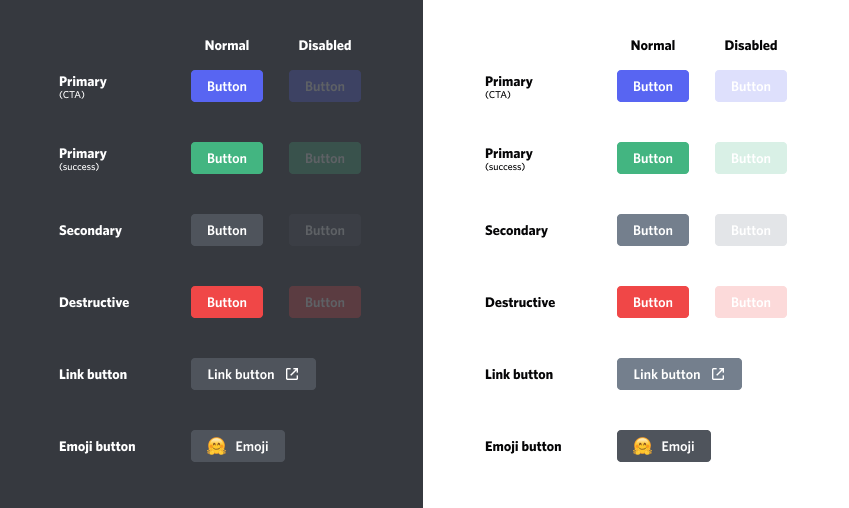

> In this entry
> - Formatting messages with embeds
> - Receiving input through buttons and select menus
> - Disabling components after a timeout
> - Creating persistent views

## Making the bot easier to use

Our bot has mostly received and returned text. Discord itself has a graphical interface, but the interaction with our bot is still rather plain. This entry looks at formatting output and providing input methods that do not require typing.

### 1. Send messages with embeds

You have probably seen Discord messages with text and images inside a bordered panel. That panel is an **embed**.



Its box and colored edge can help distinguish bot output from ordinary chat. Rich embeds can contain text and images. Video metadata is not an arbitrary field bots can populate in the same way; use a file or link for ordinary video sharing.

| Element | Purpose |
| --- | --- |
| `author` | Author information at the top |
| `color` | Accent color |
| `description` | Description below the title |
| `fields` | Named text sections |
| `footer` | Small footer text |
| `image` | Main image |
| `provider` | External provider metadata |
| `thumbnail` | Small image near the top-right |
| `timestamp` | Date and time |
| `title` | Heading |
| `type` | Embed type, normally `rich` for bot-created embeds |
| `url` | Linked URL |
| `video` | Video metadata |

> Text fields have character limits. See Discord’s [embed limits](https://discord.com/developers/docs/resources/channel#embed-object-embed-limits).
{: .prompt-warning}

`description` is not a required constructor argument. Combine the title, description, fields, and images you need, while avoiding an empty embed. The [Embed API](https://discordpy.readthedocs.io/en/stable/api.html#discord.Embed) documents the available arguments.


*Source: [b1naryth1ef](https://b1naryth1ef.github.io/disco/bot_tutorial/message_embeds.html).*

The illustration shows the positions of the elements. Discord controls their placement: a thumbnail appears near the top-right, for example, while the main image appears lower down. This limits customization but gives embeds a consistent appearance.

Let us update **/hello** to return an embed.

```python
from datetime import datetime # timestamp 시간 확인용

@bot.tree.command(name='hello', description="인사를 합니다")
async def hello(interaction: discord.Interaction):
    embed = discord.Embed(
        title="반갑습니다!",
        description="서버에 오신 것을 환영합니다.",
        color=discord.Color.gold(),
        timestamp=datetime.now(),
        url='https://sunwoo-j.github.io/'
    )
    embed.add_field(name="동해물과 백두산이", value="마르고 닳도록 하느님이 보우하사 우리나라 만세", inline=False)

    embed.add_field(name="무궁화 삼천리", value="화려강산", inline=True)
    embed.add_field(name="대한사람", value="대한으로", inline=True)
    embed.add_field(name="길이 보전하세", value="(간주)", inline=True)
    
    file = discord.File('icon.gif')
    
    embed.set_author(name="디스코드 봇 DIY", icon_url='attachment://icon.gif')
    embed.set_thumbnail(url='https://picsum.photos/100/100')
    embed.set_image(url='https://picsum.photos/600/400')
    embed.set_footer(text="Footer가 들어가는 공간", icon_url='attachment://icon.gif')
 
    await interaction.response.send_message("안녕하세요", embed=embed, file=file)
```



The example includes most commonly used elements. `discord.Embed()` sets the title, description, color, timestamp, and URL. In ordinary use, `title`, `description`, and `color` often provide a good starting point. Specify colors as hexadecimal values or use [`discord.Color`](https://discordpy.readthedocs.io/en/latest/api.html?highlight=colour#discord.Colour).

A **field** is a named text section with a `name` and `value`. `inline=False` asks for a full row; `inline=True` allows fields to share a row. Available width and the Discord client determine when fields wrap.

> [Lorem Picsum](https://picsum.photos/) can provide placeholder images for testing at different sizes.
{: .prompt-tip}

Other elements have setter methods such as `embed.set_author()`. Some accept a URL. Images can use a remote URL or an attached local file. For a local image, pass the `file` to `send_message()` and reference its attachment URL.

Finally, pass the embed to `send_message(embed=embed)`. You can send it alongside ordinary text, as in this example, or without a text message.

### 2. Add buttons

Embeds format output; they do not themselves collect input. **Message components**, such as buttons and select menus, provide interactive controls. In this example, `discord.ui.View` groups and attaches those components to the message.

Pass the view through the `view` argument of `send_message()`. The classic View used here supports five rows, with either one select menu or up to five buttons in each row. A view containing only buttons can therefore hold up to 25 of them.

```python
class ButtonView(discord.ui.View):
    @discord.ui.button(label="날 눌러요!", style=discord.ButtonStyle.primary, emoji='🙂')
    async def button_response(self, interaction: discord.Interaction, button: discord.ui.Button):
        await interaction.response.send_message("간지러워요!")

@bot.tree.command(name='버튼', description="버튼 실험용 명령어")
async def button(interaction: discord.Interaction):
    await interaction.response.send_message(view=ButtonView())
```

> `discord.ui` is included in `discord.py` 2.x. Do not install the unrelated `discord-ui` package to fix an import error. Check the active Python environment with `python -m pip show discord.py`.
{: .prompt-warning}

This example subclasses `discord.ui.View`, adds a button, and sends an instance of that view with the message.


Pressing the button calls the function decorated with `@discord.ui.button` and sends the configured response.



The button’s `style` controls its appearance. The illustrated styles correspond to `discord.ButtonStyle.primary`, `.success`, `.secondary`, `.danger`, and `.link`. A link button navigates to a URL rather than invoking a normal button callback.


The default View timeout is 180 seconds after the last interaction. Once the view stops handling input, its components can still look active, which makes it hard to tell whether they work. Let us explicitly disable the button after use or timeout.

```python
class ButtonView(discord.ui.View):
    def __init__(self, timeout):
        super().__init__(timeout=timeout)
        self.message = None
        self.button_pressed = False # 버튼을 눌렀는지 확인

    async def on_timeout(self):
        if not self.button_pressed:
            for child in self.children:
                if isinstance(child, discord.ui.Button):
                    child.disabled = True
                    child.label = "실패!"
                    child.style = discord.ButtonStyle.danger
        await self.message.edit(view=self)
        
    @discord.ui.button(label="10초 안에 누르세요!", style=discord.ButtonStyle.primary)
    async def button_response(self, interaction: discord.Interaction, button: discord.ui.Button):
        self.button_pressed = True
        button.disabled = True
        button.label = "성공!"
        button.style = discord.ButtonStyle.success
        await interaction.response.edit_message(view=self)
        
@bot.tree.command(name='버튼', description="버튼 실험용 명령어")
async def button(interaction: discord.Interaction):
    view = ButtonView(timeout=10.0)
    await interaction.response.send_message(view=view)
    view.message = await interaction.original_response()
```


`ButtonView` now receives a timeout value. Clicking before that timeout sends a success message and sets `button.disabled = True`. If ten seconds pass without a click, `on_timeout()` updates the message and disables the button. A disabled button appears dimmed and cannot be pressed.

### 3. Create a select menu

A **select menu** is a dropdown that offers a set of choices. Like a button, it belongs to a view attached to a message.

```python
class SelectView(discord.ui.View):
    @discord.ui.select(
        placeholder="국적을 선택하세요",
        min_values=1, # 골라야 할 최소 갯수
        max_values=1, # 고를 수 있는 최대 갯수
        options=[
            discord.SelectOption(
                label="대한민국",
                description="대한민국 국민입니다.",
                emoji='🇰🇷'
            ),
            discord.SelectOption(
                label="미국",
                description="미국 국민입니다.",
                emoji='🇺🇸'
            ),
            discord.SelectOption(
                label="일본",
                description="일본 국민입니다.",
                emoji='🇯🇵'
            )
        ]
    )
    async def select_response(self, interaction: discord.Interaction, select: discord.ui.Select):
        await interaction.response.send_message(f"{select.values[0]} 국적을 선택하셨습니다.")

@bot.tree.command(name='국적', description="국적을 선택합니다")
async def country(interaction: discord.Interaction):
    await interaction.response.send_message(view=SelectView())
```


Before selection, the menu displays its `placeholder`. Use that text to explain what the user should choose. The `options` parameter receives a list of `discord.SelectOption` objects.

Each option can have a `label`, `description`, and `emoji`, as illustrated by the flags. `value` defines the returned value, while `default=True` preselects an option instead of showing only the placeholder.

### 4. Specify action rows

The five rows in the classic View are called **action rows**. Components are normally arranged automatically, but the `row` parameter accepts a value from 0 to 4 to control their relative order.

```python
class ActionRowView(discord.ui.View):
    @discord.ui.button(label="버튼 1", row=0, style=discord.ButtonStyle.primary)
    async def first_button_callback(self, interaction, button):
        await interaction.response.send_message("간지러워요!")

    @discord.ui.button(label="버튼 2", row=0, style=discord.ButtonStyle.primary)
    async def second_button_callback(self, interaction, button):
        await interaction.response.send_message("간지러워요!")
    
    @discord.ui.button(label="버튼 3", row=2, style=discord.ButtonStyle.secondary)
    async def third_button_callback(self, interaction, button):
        await interaction.response.send_message("간지러워요!")
    
    @discord.ui.select(
        placeholder="저는 드롭다운 메뉴에요",
        row=1,
        options=[
            discord.SelectOption(label="1"),
            discord.SelectOption(label="2"),
            discord.SelectOption(label="3")
        ]
    )
    async def select_callback(self, interaction, select):
        await interaction.response.send_message(f"숫자 {select.values[0]}번을 골랐어요.")
        
@bot.tree.command(name='액션', description="Action Row 데모를 보여줍니다")
async def country(interaction: discord.Interaction):
    view = ActionRowView()
    await interaction.response.send_message(view=view)
```


The two buttons assigned `row=0` share a row, the select menu at `row=1` follows them, and the button at `row=2` comes below the menu. These indices order occupied rows; an unused row index does not create a visible blank gap.

You cannot add arbitrary spacing between buttons or rows this way. Moving the final button to row 3 or 4 does not introduce empty space when there are no components between them. Assigning more components than a row can contain raises an error.

### 5. Create a persistent view

A regular message’s View has no timeout when `timeout=None`. The separate 15-minute behavior applies to an ephemeral message sent with a view that has no timeout configured. A bot cannot process callbacks while offline, and it must register a persistent view again after restarting. See the [View reference](https://discordpy.readthedocs.io/en/stable/interactions/api.html#discord.ui.View).

The old message remains in the channel after a restart, but that alone does not reconnect its components to callbacks. Features such as role-selection menus need this connection to be restored. We can give the view **persistence**.

```python
class SelectView(discord.ui.View):
    def __init__(self):
        super().__init__(timeout=None) # Timeout 없애기
        self.message = None
        
    @discord.ui.select(
        custom_id='select_view', # custom_id 지정
        placeholder="국적을 선택하세요",
        options=[discord.SelectOption(label="대한민국"), discord.SelectOption(label="미국"), discord.SelectOption(label="일본")]
    )
    async def select_response(self, interaction: discord.Interaction, select: discord.ui.Select):
        await interaction.response.send_message(f"{select.values[0]} 국적을 선택하셨습니다.")

@bot.tree.command(name='국적', description="국적을 선택합니다")
async def country(interaction: discord.Interaction):
    view = SelectView()
    await interaction.response.send_message(view=view)
```

Set `timeout=None` and give every interactive component a stable `custom_id`.

```python
@bot.event
async def on_ready():
    bot.add_view(SelectView()) # 해당 View를 영속적인 객체로 지정한다
    guild = discord.utils.find(lambda g: g.id == GUILD, bot.guilds)
    print(
        f"{bot.user}(으)로 접속했습니다.\n"
        f"접속 길드: {guild.name} (ID: {guild.id})"
    )
```

Register the view with `bot.add_view()`. This example does so in `on_ready()`; a once-per-startup initialization hook is also appropriate when organizing initialization later.


After stopping and restarting the bot, the nonpersistent menu fails while the registered persistent menu continues to work.

The bot now has richer interaction, but the main file is becoming cluttered. Next we will separate features into Cogs.

## Appendix

### i. Complete code

<details>
<summary>Show code</summary>
<div markdown="1">

``` python
# bot.py
import os, discord
from discord import app_commands
from discord.ext import commands
from dotenv import load_dotenv
from datetime import datetime

load_dotenv()
TOKEN = os.getenv('BOT_TOKEN')
GUILD = int(os.getenv('GUILD_ID'))
CHANNEL = int(os.getenv('CHANNEL_ID'))
ADMIN = int(os.getenv('ADMIN_ID'))
welcome_channel = {GUILD:CHANNEL} # 길드별 환영 메시지 전송 채널

intents = discord.Intents.all()

bot = commands.Bot(command_prefix='$', intents=intents)

@bot.event
async def on_ready():
    bot.add_view(SelectView())
    guild = discord.utils.find(lambda g: g.id == GUILD, bot.guilds)
    print(
        f"{bot.user}(으)로 접속했습니다.\n"
        f"접속 길드: {guild.name} (ID: {guild.id})"
    )

@bot.event
async def setup_hook():
    await bot.tree.sync() # tree 동기화
    
@bot.event
async def on_member_join(member):
    guild_id = welcome_channel.get(member.guild.id, None)
    if guild_id is not None:
        channel = bot.get_channel(guild_id)
        await channel.send(f"{member.display_name}님이 서버에 참가하셨습니다.")

@bot.tree.command(name='hello', description="인사를 합니다")
async def hello(interaction: discord.Interaction):
    embed = discord.Embed(
        title=":raised_hands: 반갑습니다!",
        description="서버에 오신 것을 환영합니다.",
        color=discord.Color.gold(),
        timestamp=datetime.now(),
        url='https://sunwoo-j.github.io/'
    )
    embed.add_field(name="동해물과 백두산이", value="마르고 닳도록 하느님이 보우하사 우리나라 만세", inline=False)

    embed.add_field(name="무궁화 삼천리", value="화려강산", inline=True)
    embed.add_field(name="대한사람", value="대한으로", inline=True)
    embed.add_field(name="길이 보전하세", value="(간주)", inline=True)
    
    file = discord.File('icon.gif')
    
    embed.set_author(name="디스코드 봇 DIY", icon_url='attachment://icon.gif')
    embed.set_thumbnail(url='https://picsum.photos/100/100')
    embed.set_field_at
    embed.set_image(url='https://picsum.photos/600/400')
    embed.set_footer(text="Footer가 들어가는 공간", icon_url='attachment://icon.gif')

    await interaction.response.send_message("안녕하세요", embed=embed, file=file)

class ButtonView(discord.ui.View):
    def __init__(self, timeout):
        super().__init__(timeout=timeout)
        self.message = None
        self.button_pressed = False

    async def on_timeout(self):
        if not self.button_pressed:
            for child in self.children:
                if isinstance(child, discord.ui.Button):
                    child.disabled = True
                    child.label = "실패!"
                    child.style = discord.ButtonStyle.danger
        await self.message.edit(view=self)
        
    @discord.ui.button(label="10초 안에 누르세요!", style=discord.ButtonStyle.primary)
    async def button_response(self, interaction: discord.Interaction, button: discord.ui.Button):
        self.button_pressed = True
        button.disabled = True
        button.label = "성공!"
        button.style = discord.ButtonStyle.success
        await interaction.response.edit_message(view=self)
        
@bot.tree.command(name='버튼', description="버튼 실험용 명령어")
async def button(interaction: discord.Interaction):
    view = ButtonView(timeout=10.0)
    await interaction.response.send_message(view=view)
    view.message = await interaction.original_response()
    
class SelectView(discord.ui.View):
    def __init__(self):
        super().__init__(timeout=None)
        self.message = None
        
    @discord.ui.select(
        custom_id='select_view',
        placeholder="국적을 선택하세요",
        min_values=1, # 골라야 할 최소 갯수
        max_values=1, # 고를 수 있는 최대 갯수
        options=[
            discord.SelectOption(
                label="대한민국",
                description="대한민국 국민입니다.",
                emoji='🇰🇷'
            ),
            discord.SelectOption(
                label="미국",
                description="미국 국민입니다.",
                emoji='🇺🇸'
            ),
            discord.SelectOption(
                label="일본",
                description="일본 국민입니다.",
                emoji='🇯🇵'
            )
        ]
    )
    async def select_response(self, interaction: discord.Interaction, select: discord.ui.Select):
        await interaction.response.edit_message(content=f"{select.values[0]} 국적을 선택하셨습니다.")

@bot.tree.command(name='국적', description="국적을 선택합니다")
async def country(interaction: discord.Interaction):
    view = SelectView()
    await interaction.response.send_message(view=view)
    
class ActionRowView(discord.ui.View):
    @discord.ui.button(label="버튼 1", row=0, style=discord.ButtonStyle.primary)
    async def first_button_callback(self, interaction, button):
        await interaction.response.send_message("간지러워요!")

    @discord.ui.button(label="버튼 2", row=0, style=discord.ButtonStyle.primary)
    async def second_button_callback(self, interaction, button):
        await interaction.response.send_message("간지러워요!")
    
    @discord.ui.button(label="버튼 3", row=2, style=discord.ButtonStyle.secondary)
    async def third_button_callback(self, interaction, button):
        await interaction.response.send_message("간지러워요!")
    
    @discord.ui.select(
        placeholder="저는 드롭다운 메뉴에요",
        row=1,
        options=[
            discord.SelectOption(label="1"),
            discord.SelectOption(label="2"),
            discord.SelectOption(label="3")
        ]
    )
    async def select_callback(self, interaction, select):
        await interaction.response.send_message(f"숫자 {select.values[0]}번을 골랐어요.")
        
@bot.tree.command(name='액션', description="Action Row 데모를 보여줍니다")
async def country(interaction: discord.Interaction):
    view = ActionRowView()
    await interaction.response.send_message(view=view)

@bot.tree.command(name='곱하기', description="숫자 두 개를 곱합니다")
@app_commands.describe(정수1="첫 번째 정수", 정수2="두 번째 정수")
async def multiply(interaction: discord.Interaction, 정수1: int, 정수2: int):
    product = 정수1 * 정수2
    await interaction.response.send_message(f"결과는 {product}입니다.")

@bot.tree.command(name='참가일', description="멤버의 서버 참가 날짜를 알려줍니다")
@app_commands.describe(member="조회할 멤버")
async def joined(interaction: discord.Interaction, member: discord.Member):
    join_date = member.joined_at.strftime("%Y-%m-%d")
    await interaction.response.send_message(f"{member.display_name}님은 {join_date}에 서버에 참가했습니다.")

@bot.tree.context_menu(name="참가일")
async def joined_user_menu(interaction: discord.Interaction, member: discord.Member):
    join_date = member.joined_at.strftime("%Y-%m-%d")
    await interaction.response.send_message(f"{member.display_name}님은 {join_date}에 서버에 참가했습니다.")
    
@bot.tree.context_menu(name="글자수")
async def character_count(interaction: discord.Interaction, message: discord.Message):
    characters = len(message.content)
    characters_no_space = len(message.content.replace(' ', ''))
    await interaction.response.send_message(f"공백 포함 {characters}자, 공백 제외 {characters_no_space}자")

bot.run(TOKEN)
```

</div>
</details>

### ii. Folder structure

```tree
📦Discord Bot
 ┣ 📂cogs
 ┃ ┣ 📜interface.py
 ┃ ┗ 📜welcome.py
 ┣ 📜.env
 ┣ 📜bot.py
 ┣ 📜icon.gif
 ┗ 📜thumbnail.png
```

### iii. GitHub repository

<https://github.com/sunwoo-j/discord-bot-diy>
