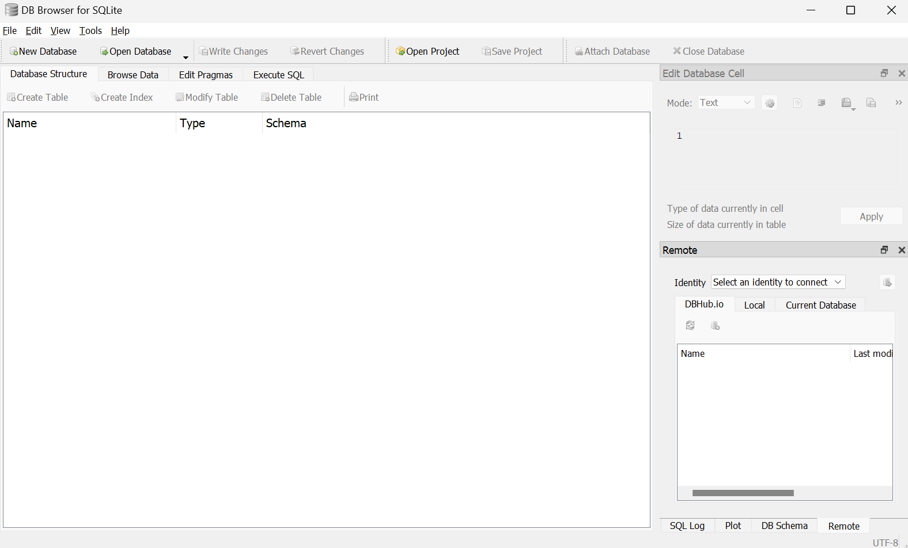
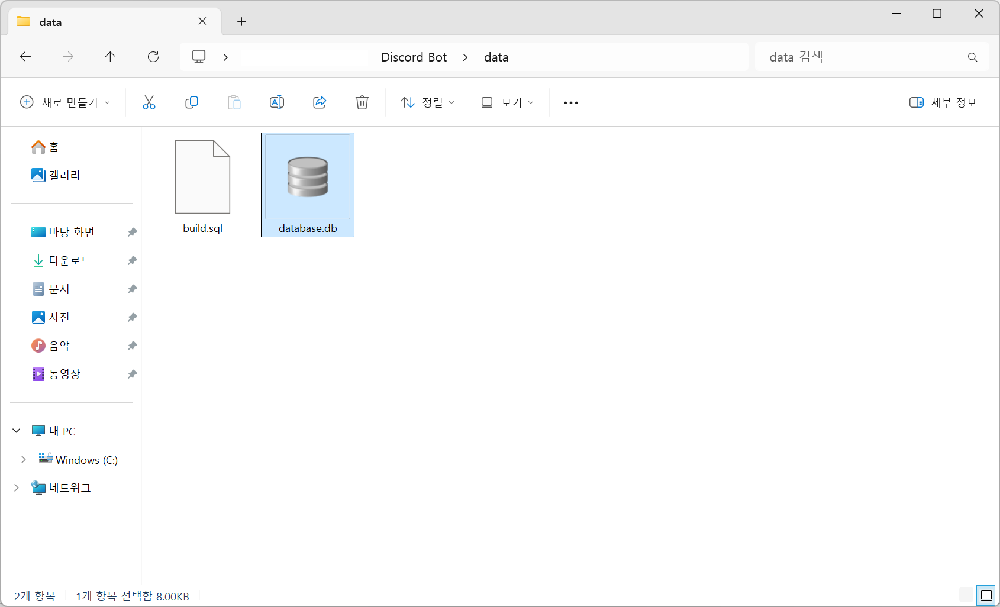
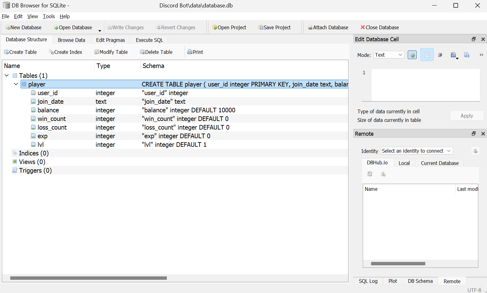
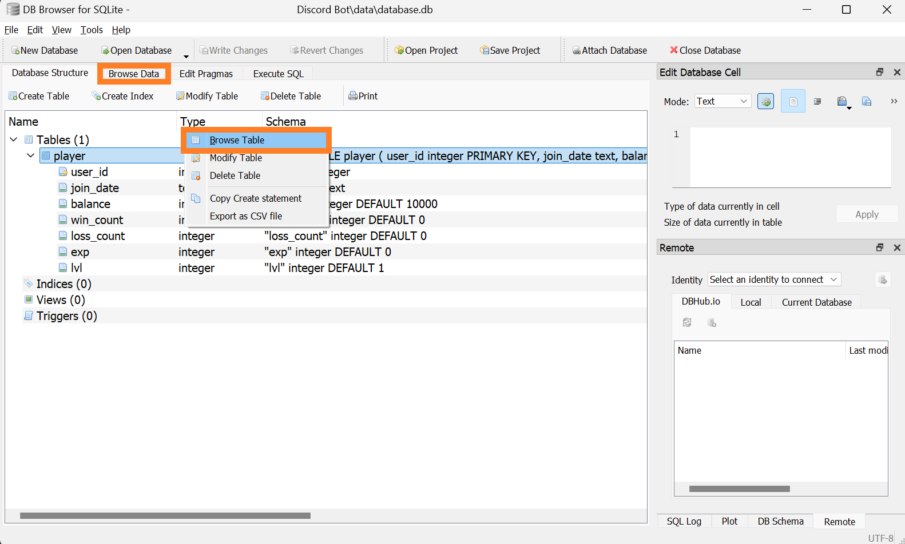
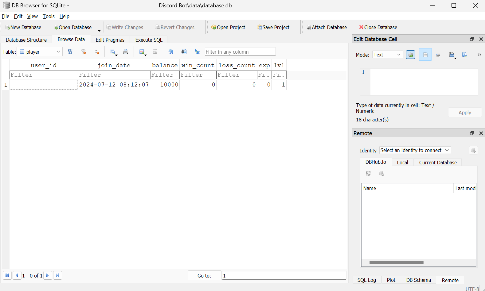
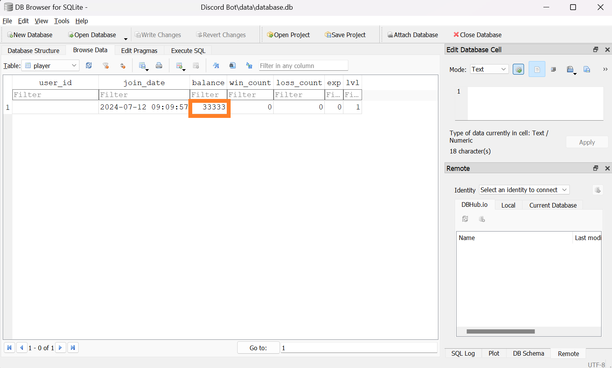
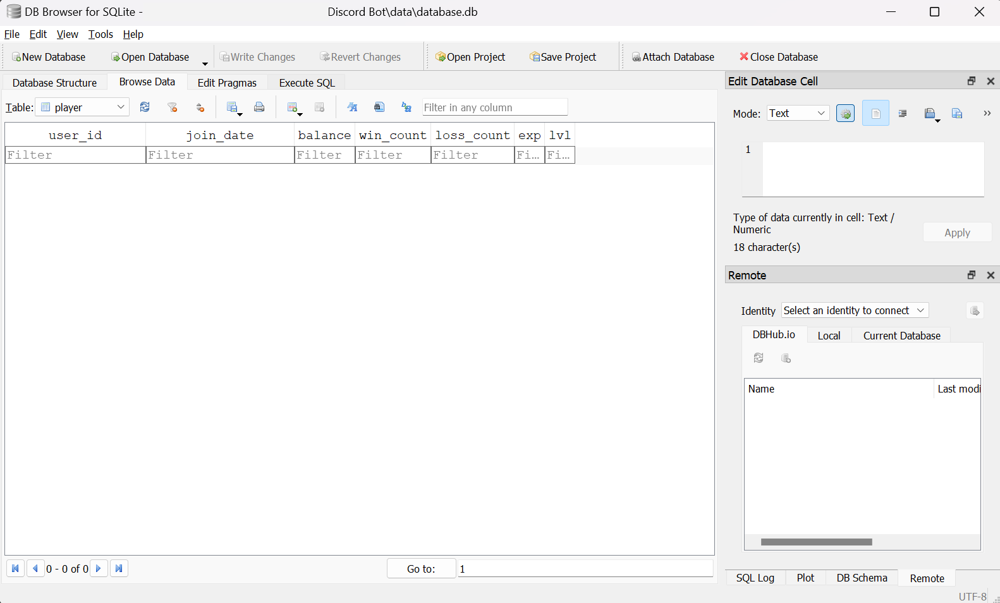
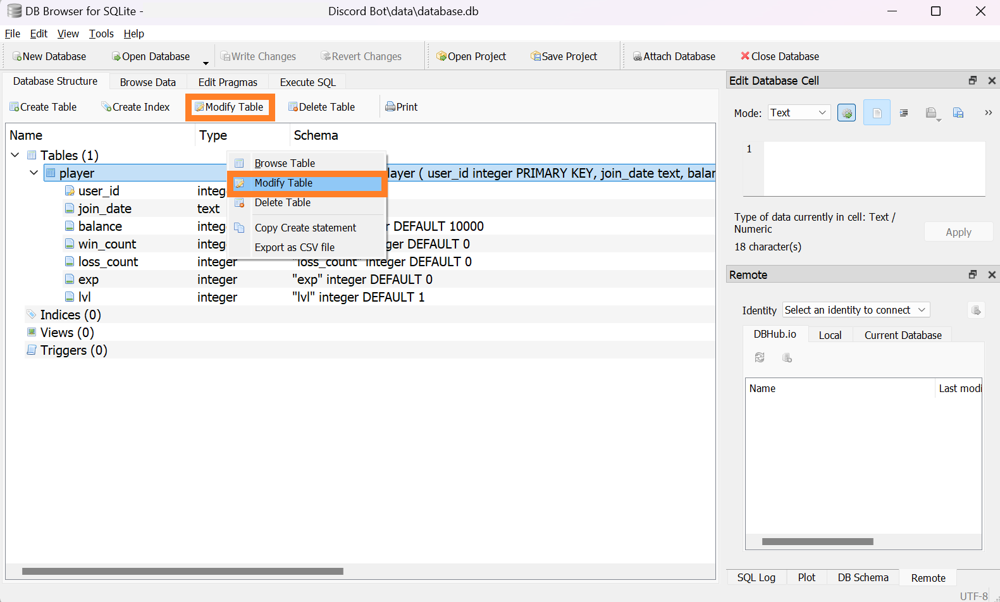

> In this entry
> - Creating a SQLite database
> - Writing data
> - Reading data back

## Why a database matters

A **database** gives the bot a structured way to store, retrieve, and manage information. This helps in several ways:

1. **Persistence.** Data held only in memory disappears when the process stops. A database can preserve user information and statistics across restarts.
2. **Efficient management.** Structured records make it possible to retrieve the data we need without scanning an improvised collection of files.
3. **Integrity and consistency.** Constraints and transactions help keep related changes consistent, including when several users interact with the bot.
4. **Growth.** As the bot gains features, its data model can grow with it.
5. **Richer features.** Rankings, statistics, and per-user settings benefit from queries and structured storage.

Choosing and configuring storage carefully is an important part of making the bot reliable.

## Setting up SQLite

**SQLite** is a lightweight **relational database management system**. It runs without a separate database server and stores a database in a file, making it convenient at this stage of the project. If workload and concurrency requirements later outgrow it, I will consider PostgreSQL.

A spreadsheet file could also store information, but this project needs SQL queries and transactions. When inspecting or editing the SQLite file with another program, remember that simultaneous writes can encounter locking conflicts.

### 1. Check the sqlite3 module

Python provides the `sqlite3` module for working with SQLite.

```bash
python -c "import sqlite3; print(sqlite3.sqlite_version)"
```

In a standard Python installation, this is part of the **standard library**, so do not try to install it with `pip`. The command above checks that it imports and prints the SQLite version. If the module is unavailable, check your Python distribution’s SQLite support.

> See the [Python documentation](https://docs.python.org/3/library/sqlite3.html) for its API.
{: .prompt-info}

### 2. Install DB Browser for SQLite

**DB Browser for SQLite** provides a graphical interface for inspecting and editing `.db` and `.sqlite` files.

Use the [download page](https://sqlitebrowser.org/dl/) to choose an installer for your operating system. The original Windows example used the [64-bit standard installer](https://download.sqlitebrowser.org/DB.Browser.for.SQLite-3.12.2-win64.msi).



We could create a database through the graphical tool, but we will instead let the code create it when it does not yet exist.

## Working with the database

Our first database will store player information for the bot’s features, such as experience and balances.

Rather than automatically collecting every guild member’s information, the bot will record users who explicitly register. In this series, a **player** means a Discord user who has registered with the bot.

### 1. Create the database

Create `db/db.py` to group database operations, and a separate `data/` directory for the database file and schema script.

```tree
📦Discord Bot
 ┣ 📂cogs
 ┃ ┣ 📜interface.py
 ┃ ┗ 📜welcome.py
 ┣ 📂data
 ┣ 📂db
 ┃ ┗ 📜db.py
 ┣ 📜.env
 ┗ 📜bot.py
```

First, establish a connection.

```python
# db/db.py
import sqlite3, os.path

DB_PATH = 'data/database.db'
BUILD_PATH = 'data/build.sql'
```

Import `sqlite3` and define `DB_PATH` for the database file and `BUILD_PATH` for the schema script. We will write that script shortly; the database file itself does not need to be created manually.

```python
# db/db.py
...
con = sqlite3.connect(DB_PATH)
cur = con.cursor()
```

`sqlite3.connect(DB_PATH)` returns a connection stored in `con`. If the file does not exist, SQLite creates it. A **cursor** executes SQL statements and retrieves result rows. Connection convenience methods such as `con.execute()` also create a cursor internally.

Next, define initialization helpers.

```python
# db/db.py
...
def with_commit(func):
    def inner(*args, **kwargs):
        result = func(*args, **kwargs)
        commit()
        return result
    return inner

@with_commit
def build():
    if os.path.isfile(BUILD_PATH):
        scriptexec(BUILD_PATH)

def commit():
    con.commit()

def scriptexec(path):
    with open(path, 'r', encoding='utf-8') as script:
        cur.executescript(script.read())
```

`commit()` calls the connection’s method to persist pending changes.

> In this example’s transaction configuration, changes that have not been committed can be lost when the process exits.
{: .prompt-warning}

The `with_commit` decorator runs `commit()` after a decorated function succeeds, helping us avoid forgetting it for individual write operations. This simple helper is not a full transaction-management system; operations that must succeed together need an appropriate transaction boundary.

`build()` checks whether the schema script exists, then calls `scriptexec()` to execute it. Create `data/build.sql`:

```tree
📦Discord Bot
 ┣ 📂cogs
 ┃ ┗ ...
 ┣ 📂data
 ┃ ┗ 📜build.sql
 ┣ 📂db
 ┃ ┗ ...
 ┗ ...
```

Add the following SQL:

```sql
-- data/build.sql
CREATE TABLE IF NOT EXISTS player (
    user_id integer PRIMARY KEY,
    join_date text,
    balance integer DEFAULT 10000,
    win_count integer DEFAULT 0,
    loss_count integer DEFAULT 0,
    exp integer DEFAULT 0,
    lvl integer DEFAULT 1
);
```

`CREATE TABLE IF NOT EXISTS` creates `player` only when it does not already exist.

| Column | Data type | Purpose |
| --- | --- | --- |
| `user_id` | integer | Unique player identifier, primary key |
| `join_date` | text | Registration time |
| `balance` | integer | Current balance |
| `win_count` | integer | Wins |
| `loss_count` | integer | Losses |
| `exp` | integer | Experience |
| `lvl` | integer | Level |

`user_id` identifies a record uniquely; our registration code supplies the Discord user’s ID. `join_date` stores a timestamp as text. Other columns have defaults, so omitting them from an insert supplies their initial values. In particular, `DEFAULT 10000` gives a newly registered player an initial balance of 10,000.

We have defined initialization, but still need to invoke it. Add `db/__init__.py`.

> A package’s `__init__.py` normally runs when it is first imported in a process. Repeated imports use cached modules rather than executing it again each time.
{: .prompt-info}

```python
# db/__init__.py
from . import db

db.build()
```

This calls `build()` when the package is initialized, executing the schema and creating the player table.



Running the bot creates `data/database.db`.



Open the file in DB Browser to inspect the player table and its columns.

### 2. Insert data

Now that the table exists, we can add records.

```python
# db/db.py
...
@with_commit
def execute(command, values):
    cur.execute(command, values)
    return cur.rowcount
```

The `execute()` helper executes an SQL statement. `cur.rowcount` reports how many rows a supported write statement affected, which will help us determine whether an operation found a player.

Create a player-related module under `cogs/` and add a registration command.

```python
# cogs/player.py
import discord, sqlite3
from discord import app_commands
from discord.ext import commands
from db import db

class Player(commands.Cog):
    def __init__(self, bot):
        self.bot = bot
        
    @app_commands.command(name='플레이어등록', description="본인을 플레이어로 등록합니다.")
    async def player_register(self, interaction: discord.Interaction):
        user_id = interaction.user.id
        join_date = datetime.now(timezone.utc).strftime('%Y-%m-%d %H:%M:%S') # UTC 시간 불러오기
        try: # 플레이어 등록 시도
            db.execute("INSERT INTO player (user_id, join_date) VALUES (?, ?)", user_id, join_date)
            await interaction.response.send_message("플레이어로 등록되었습니다.")
        except sqlite3.IntegrityError as e:
            if "UNIQUE constraint failed" in str(e):
                await interaction.response.send_message("이미 등록된 플레이어입니다.")
            else:
                await interaction.response.send_message(f"등록 중에 오류가 발생했습니다: {e}")
        
async def setup(bot):
    await bot.add_cog(Player(bot))
```

`INSERT INTO player ...` creates a record with the supplied `user_id` and `join_date`. We use the Discord account’s unique ID and the current time.

> Pass values separately using SQLite’s `?` placeholders. The protection comes from [parameter binding](https://docs.python.org/3.12/library/sqlite3.html#sqlite3-placeholders), rather than the punctuation itself. Do not build SQL by concatenating user input.
{: .prompt-info}

The command catches a duplicate-key error when the user is already registered. SQLite also supports `INSERT OR IGNORE INTO`, which can skip a conflicting insert without raising that exception. Here I keep the exception so the bot can explain the duplicate registration.


Registering works; trying again produces the duplicate-registration response.



In DB Browser, right-click `player` and choose **Browse Table**, or open **Browse Data**.



The Discord user ID and registration time appear in the new record.

> If the inserted record is not visible, check that the write was committed and refresh the browser’s view.
{: .prompt-warning}

### 3. Query data

Add two read helpers to `db.py`.

```python
# db/db.py
...
def field(command, *values):
    cur.execute(command, values)
    fetch = cur.fetchone()
    return fetch[0] if fetch else None

def record(command, *values):
    cur.execute(command, values)
    return cur.fetchone()
```

`field()` returns one column value, useful when we need only a balance. `record()` returns an entire row, useful when several player attributes are needed together.

```python
# cogs/player.py
    ...
    @app_commands.command(name='잔액', description="현재 보유 중인 금액을 확인합니다.")
        async def get_balance(self, interaction: discord.Interaction):
            user_id = interaction.user.id
            balance = db.field("SELECT balance FROM player WHERE user_id = ?", user_id) or None

            if balance:
                await interaction.response.send_message(f"현재 잔액은 ${balance:,}입니다.")
            else:
                await interaction.response.send_message("불러올 수 없습니다.")
```

The balance command looks up `balance` for the supplied `user_id` using `field()`.

```python
# cogs/player.py
    ...
    @app_commands.command(description="플레이어의 정보를 조회합니다.")
    @app_commands.describe(player="조회할 플레이어")
    @app_commands.rename(player='플레이어')
    async def 플레이어정보(self, interaction: discord.Interaction, player: discord.User):
        user_id = player.id
        player_info = db.record("SELECT join_date, win_count, loss_count, exp, lvl FROM player WHERE user_id = ?", user_id)
        join_date, win_count, loss_count, exp, lvl = player_info or (None, None, None, None, None)

        if player_info:
            embed = discord.Embed(
                title=f"{player.display_name}님의 정보",
                color=discord.Color.blue()
            )
            embed.add_field(name="가입일", value=join_date, inline=False)
            embed.add_field(name="도박 전적", value=f"{win_count} 승 / {loss_count} 패", inline=False)
            embed.add_field(name="레벨 / 경험치", value=f"{lvl} 레벨 / {exp}", inline=False)
            await interaction.response.send_message(embed=embed)
        else:
            await interaction.response.send_message("불러올 수 없습니다.")
```

The next command uses `record()` to fetch multiple fields.

> `@app_commands.rename()` changes the parameter name shown in Discord’s interface.
{: .prompt-info}


The command finds the matching player record and displays the player’s information, excluding the balance, in an embed.

### 4. Update data

Use `UPDATE ... SET ... WHERE ...` to change an existing record. Let us add an administrator-only balance command.

```python
# cogs/player.py
    ...
    @app_commands.command(description="플레이어의 잔액을 변경합니다.")
    @app_commands.describe(player="변경할 플레이어", new_balance="설정할 잔액")
    @app_commands.rename(player='플레이어', new_balance='신규잔액')
    async def 잔액변경(self, interaction: discord.Interaction, player: discord.User, new_balance: int):
        if interaction.user.guild_permissions.administrator:
            user_id = player.id
            affected_rows = db.execute("UPDATE player SET balance = ? WHERE user_id = ?", new_balance, user_id)

            if affected_rows > 0:
                await interaction.response.send_message(
                    f"{player.display_name}님의 잔액을 ${new_balance:,}로 변경했습니다."
                )
            else:
                await interaction.response.send_message("플레이어로 등록되지 않은 사용자입니다.")
        else:
            await interaction.response.send_message("권한이 없습니다.")
```

If `affected_rows` is zero in this example, no player matched the supplied ID, so the bot returns a different response.


An existing player’s balance changes to the requested amount. A missing player gets an explanatory message.



DB Browser shows the example balance of 33333.

> If the value appears unchanged, refresh the table using the toolbar’s refresh button.
{: .prompt-info}

### 5. Delete data

Use `DELETE FROM ... WHERE ...` to remove a record. This command unregisters a player.

```python
# cogs/player.py
    ...
    @app_commands.command(name='플레이어탈퇴', description="플레이어 탈퇴를 진행합니다.")
    async def player_delete(self, interaction: discord.Interaction):
        user_id = interaction.user.id
        affected_rows = db.execute("DELETE FROM player WHERE user_id = ?", user_id)

        if affected_rows > 0:
            await interaction.response.send_message("플레이어 탈퇴가 완료되었습니다.")
        else:
            await interaction.response.send_message("플레이어로 등록되지 않은 사용자입니다.")
```


As with the update, an affected row indicates a successful deletion; zero indicates no matching player.



The player is no longer present in DB Browser.

### 6. Other database operations

Our decorator commits after each successful write. If you manage commits manually instead, `con.rollback()` can undo pending changes before they are committed.

```python
# db/db.py
...
def close():
    con.close()
```

`close()` ends the connection. The running bot keeps its connection open because it needs to continue using the database. Closing without committing pending changes does not save them.

DB Browser also lets us maintain the schema.



Select a table and choose **Modify Table** from its context menu or the toolbar.


The dialog lets you edit column names, types, primary-key settings, and defaults without manually writing the SQL. Avoid conflicting writes while the bot is using the database.

We now have the basic operations needed for persistent storage. Future entries can build experience systems, games, a virtual economy, and per-guild configuration on top of this foundation.

## Appendix

### i. Complete code

<details>
<summary>Show code</summary>
<div markdown="1">

```python
# bot.py
import os, discord
from discord import app_commands
from discord.ext import commands
from dotenv import load_dotenv
from cogs.interface import SelectView

load_dotenv()
TOKEN = os.getenv('BOT_TOKEN')
GUILD = int(os.getenv('GUILD_ID'))
CHANNEL = int(os.getenv('CHANNEL_ID'))
ADMIN = int(os.getenv('ADMIN_ID'))
welcome_channel = {GUILD:CHANNEL} # 길드별 환영 메시지 전송 채널

intents = discord.Intents.all()

bot = commands.Bot(command_prefix='$', intents=intents)

async def load_extensions():
    for filename in os.listdir('cogs'):
        if filename.endswith('.py'):
            extension = 'cogs.' + filename[:-3]
            print(f"{extension} 모듈을 불러왔습니다.")
            await bot.load_extension(extension)

@bot.event
async def on_ready():
    bot.add_view(SelectView())
    guild = discord.utils.find(lambda g: g.id == GUILD, bot.guilds)
    print(
        f"{bot.user}(으)로 접속했습니다.\n"
        f"접속 길드: {guild.name} (ID: {guild.id})"
    )

@bot.event
async def setup_hook():
    await load_extensions()
    await bot.tree.sync() # tree 동기화
    
@bot.command(name='unload')
@commands.is_owner()
async def unload(ctx, extension: str):
    try:
        await bot.unload_extension(f'cogs.{extension}')
        await ctx.send(f'{extension} Cog를 제거했습니다.')
    except Exception as e:
        await ctx.send(f'오류: {e}')

@bot.command(name='load')
@commands.is_owner()
async def unload(ctx, extension: str):
    try:
        await bot.load_extension(f'cogs.{extension}')
        await ctx.send(f'{extension} Cog를 불러왔습니다.')
        await bot.tree.sync()
    except Exception as e:
        await ctx.send(f'오류: {e}')

@bot.command(name='reload')
@commands.is_owner()
async def reload(ctx, extension: str):
    try:
        await bot.reload_extension(f'cogs.{extension}')
        await ctx.send(f'{extension} Cog를 다시 불러왔습니다.')
        await bot.tree.sync()
    except Exception as e:
        await ctx.send(f'오류: {e}')

@bot.tree.command(name='곱하기', description="숫자 두 개를 곱합니다")
@app_commands.describe(정수1="첫 번째 정수", 정수2="두 번째 정수")
async def multiply(interaction: discord.Interaction, 정수1: int, 정수2: int):
    product = 정수1 * 정수2
    await interaction.response.send_message(f"결과는 {product}입니다.")

@bot.tree.command(name='참가일', description="멤버의 서버 참가 날짜를 알려줍니다")
@app_commands.describe(멤버="조회할 멤버")
async def joined(interaction: discord.Interaction, 멤버: discord.Member):
    join_date = 멤버.joined_at.strftime("%Y-%m-%d")
    await interaction.response.send_message(f"{멤버.display_name}님은 {join_date}에 서버에 참가했습니다.")

@bot.tree.context_menu(name="참가일")
async def joined_user_menu(interaction: discord.Interaction, member: discord.Member):
    join_date = member.joined_at.strftime("%Y-%m-%d")
    await interaction.response.send_message(f"{member.display_name}님은 {join_date}에 서버에 참가했습니다.")
    
@bot.tree.context_menu(name="글자수")
async def character_count(interaction: discord.Interaction, message: discord.Message):
    characters = len(message.content)
    characters_no_space = len(message.content.replace(' ', ''))
    await interaction.response.send_message(f"공백 포함 {characters}자, 공백 제외 {characters_no_space}자")

bot.run(TOKEN)
```

```python
# cogs/interface.py
import discord
from discord import app_commands
from discord.ext import commands

class ButtonView(discord.ui.View):
    def __init__(self, timeout):
        super().__init__(timeout=timeout)
        self.message = None
        self.button_pressed = False

    async def on_timeout(self):
        if not self.button_pressed:
            for child in self.children:
                if isinstance(child, discord.ui.Button):
                    child.disabled = True
                    child.label = "실패!"
                    child.style = discord.ButtonStyle.danger
        await self.message.edit(view=self)
        
    @discord.ui.button(label="10초 안에 누르세요!", style=discord.ButtonStyle.primary)
    async def button_response(self, interaction: discord.Interaction, button: discord.ui.Button):
        self.button_pressed = True
        button.disabled = True
        button.label = "성공!"
        button.style = discord.ButtonStyle.success
        await interaction.response.edit_message(view=self)

class SelectView(discord.ui.View):
    def __init__(self):
        super().__init__(timeout=None)
        self.message = None
        
    @discord.ui.select(
        custom_id='select_view',
        placeholder="국적을 선택하세요",
        min_values=1, # 골라야 할 최소 갯수
        max_values=1, # 고를 수 있는 최대 갯수
        options=[
            discord.SelectOption(
                label="대한민국",
                description="대한민국 국민입니다.",
                emoji='🇰🇷'
            ),
            discord.SelectOption(
                label="미국",
                description="미국 국민입니다.",
                emoji='🇺🇸'
            ),
            discord.SelectOption(
                label="일본",
                description="일본 국민입니다.",
                emoji='🇯🇵'
            )
        ]
    )
    async def select_response(self, interaction: discord.Interaction, select: discord.ui.Select):
        await interaction.response.edit_message(content=f"{select.values[0]} 국적을 선택하셨습니다.")
    
class ActionRowView(discord.ui.View):
    @discord.ui.button(label="버튼 1", row=0, style=discord.ButtonStyle.primary)
    async def first_button_callback(self, interaction, button):
        await interaction.response.send_message("간지러워요!")

    @discord.ui.button(label="버튼 2", row=0, style=discord.ButtonStyle.primary)
    async def second_button_callback(self, interaction, button):
        await interaction.response.send_message("간지러워요!")
    
    @discord.ui.button(label="버튼 3", row=2, style=discord.ButtonStyle.secondary)
    async def third_button_callback(self, interaction, button):
        await interaction.response.send_message("간지러워요!")
    
    @discord.ui.select(
        placeholder="저는 드롭다운 메뉴에요",
        row=1,
        options=[
            discord.SelectOption(label="1"),
            discord.SelectOption(label="2"),
            discord.SelectOption(label="3")
        ]
    )
    async def select_callback(self, interaction, select):
        await interaction.response.send_message(f"숫자 {select.values[0]}번을 골랐어요.")
        
class Interface(commands.Cog):
    def __init__(self, bot):
        self.bot = bot

    @app_commands.command(name='버튼', description="버튼 실험용 명령어")
    async def button(self, interaction: discord.Interaction):
        view = ButtonView(timeout=10.0)
        await interaction.response.send_message(view=view)
        view.message = await interaction.original_response()

    @app_commands.command(name='국적', description="국적을 선택합니다")
    async def country(self, interaction: discord.Interaction):
        view = SelectView()
        await interaction.response.send_message(view=view)
            
    @app_commands.command(name='액션', description="Action Row 데모를 보여줍니다")
    async def country(self, interaction: discord.Interaction):
        view = ActionRowView()
        await interaction.response.send_message(view=view)
    
    @app_commands.command(name='추가', description="새로운 명령어")
    async def new_command(self, interaction: discord.Interaction):
        await interaction.response.send_message("새로 만들어졌어요.")

async def setup(bot):
    await bot.add_cog(Interface(bot))
    
async def teardown(bot):
    print("몸이 이상해요..")
```

```python
# cogs/player.py
import discord, sqlite3
from discord import app_commands
from discord.ext import commands
from datetime import datetime, timezone
from db import db

class Player(commands.Cog):
    def __init__(self, bot):
        self.bot = bot
        
    @app_commands.command(name='플레이어등록', description="본인을 플레이어로 등록합니다.")
    async def player_register(self, interaction: discord.Interaction):
        user_id = interaction.user.id
        join_date = datetime.now(timezone.utc).strftime('%Y-%m-%d %H:%M:%S')
        try: # 플레이어 등록 시도
            db.execute("INSERT INTO player (user_id, join_date) VALUES (?, ?)", user_id, join_date)
            await interaction.response.send_message("플레이어로 등록되었습니다.")
        except sqlite3.IntegrityError as e:
            if "UNIQUE constraint failed" in str(e):
                await interaction.response.send_message("이미 등록된 플레이어입니다.")
            else:
                await interaction.response.send_message(f"등록 중에 오류가 발생했습니다: {e}")
                
    @app_commands.command(name='플레이어탈퇴', description="플레이어 탈퇴를 진행합니다.")
    async def player_delete(self, interaction: discord.Interaction):
        user_id = interaction.user.id
        affected_rows = db.execute("DELETE FROM player WHERE user_id = ?", user_id)
        
        if affected_rows > 0:
            await interaction.response.send_message("플레이어 탈퇴가 완료되었습니다.")
        else:
            await interaction.response.send_message("플레이어로 등록되지 않은 사용자입니다.")
                
    @app_commands.command(description="현재 보유 중인 금액을 확인합니다.")
    @app_commands.describe(플레이어="조회할 플레이어")
    async def 잔액(self, interaction: discord.Interaction, 플레이어: discord.User):
        user_id = 플레이어.id
        balance = db.field("SELECT balance FROM player WHERE user_id = ?", user_id) or None

        if balance:
            await interaction.response.send_message(f"현재 잔액은 ${balance:,}입니다.")
        else:
            await interaction.response.send_message("불러올 수 없습니다.")
            
    @app_commands.command(description="플레이어의 정보를 조회합니다.")
    @app_commands.describe(player="조회할 플레이어")
    @app_commands.rename(player='플레이어')
    async def 플레이어정보(self, interaction: discord.Interaction, player: discord.User):
        user_id = player.id
        player_info = db.record("SELECT join_date, win_count, loss_count, exp, lvl FROM player WHERE user_id = ?", user_id)
        join_date, win_count, loss_count, exp, lvl = player_info or (None, None, None, None, None)

        if player_info:
            embed = discord.Embed(
                title=f"{player.display_name}님의 정보",
                color=discord.Color.blue()
            )
            embed.add_field(name="가입일", value=join_date, inline=False)
            embed.add_field(name="도박 전적", value=f"{win_count} 승 / {loss_count} 패", inline=False)
            embed.add_field(name="레벨 / 경험치", value=f"{lvl} 레벨 / {exp}", inline=False)
            await interaction.response.send_message(embed=embed)
        else:
            await interaction.response.send_message("불러올 수 없습니다.")
            
    @app_commands.command(description="플레이어의 잔액을 변경합니다.")
    @app_commands.describe(player="변경할 플레이어", new_balance="설정할 잔액")
    @app_commands.rename(player='플레이어', new_balance='신규잔액')
    async def 잔액변경(self, interaction: discord.Interaction, player: discord.User, new_balance: int):
        if interaction.user.guild_permissions.administrator:
            user_id = player.id
            affected_rows = db.execute("UPDATE player SET balance = ? WHERE user_id = ?", new_balance, user_id)

            if affected_rows > 0:
                await interaction.response.send_message(f"{player.display_name}님의 잔액을 ${new_balance:,}로 변경했습니다.")
            else:
                await interaction.response.send_message("플레이어로 등록되지 않은 사용자입니다.")
        else:
            await interaction.response.send_message("권한이 없습니다.")
        
async def setup(bot):
    await bot.add_cog(Player(bot))
```

```python
import discord
from discord import app_commands
from discord.ext import commands
from datetime import datetime

class Welcome(commands.Cog):
    def __init__(self, bot):
        self.bot = bot
        
    @commands.Cog.listener()
    async def on_member_join(self, member):
        channel = member.guild.system_channel
        if channel is not None:
            await channel.send(f"{member.display_name}님이 서버에 참가하셨습니다.")
    
    @app_commands.command(name='hello', description="인사를 합니다")
    async def hello(self, interaction: discord.Interaction):
        embed = discord.Embed(
            title=":raised_hands: 반갑습니다!",
            description="서버에 오신 것을 환영합니다.",
            color=discord.Color.gold(),
            timestamp=datetime.now(),
            url='https://sunwoo-j.github.io/'
        )
        embed.add_field(name="동해물과 백두산이", value="마르고 닳도록 하느님이 보우하사 우리나라 만세", inline=False)

        embed.add_field(name="무궁화 삼천리", value="화려강산", inline=True)
        embed.add_field(name="대한사람", value="대한으로", inline=True)
        embed.add_field(name="길이 보전하세", value="(간주)", inline=True)
        
        file = discord.File('./icon.gif')
        
        embed.set_author(name="디스코드 봇 DIY", icon_url='attachment://icon.gif')
        embed.set_thumbnail(url='https://picsum.photos/100/100')
        embed.set_field_at
        embed.set_image(url='https://picsum.photos/600/400')
        embed.set_footer(text="Footer가 들어가는 공간", icon_url='attachment://icon.gif')
    
        await interaction.response.send_message("안녕하세요", embed=embed, file=file)
    
async def setup(bot):
    await bot.add_cog(Welcome(bot))
```

```sql
-- data/build.sql
CREATE TABLE IF NOT EXISTS player (
    user_id integer PRIMARY KEY,
    join_date text,
    balance integer DEFAULT 10000,
    win_count integer DEFAULT 0,
    loss_count integer DEFAULT 0,
    exp integer DEFAULT 0,
    lvl integer DEFAULT 1
);
```

```python
# db/__init__.py
from . import db

db.build()
```

```python
# db/db.py
import sqlite3, os.path

DB_PATH = './data/database.db'
BUILD_PATH = './data/build.sql'

con = sqlite3.connect(DB_PATH, check_same_thread=False)
cur = con.cursor()

def with_commit(func):
    def inner(*args, **kwargs):
        result = func(*args, **kwargs)
        commit()
        return result
    return inner

@with_commit
def build():
    if os.path.isfile(BUILD_PATH):
        scriptexec(BUILD_PATH)

def commit():
    con.commit()

def close():
    con.close()

def field(command, *values):
    cur.execute(command, values)
    fetch = cur.fetchone()
    return fetch[0] if fetch else None

def record(command, *values):
    cur.execute(command, values)
    return cur.fetchone()

def column(command, *values):
    cur.execute(command, values)
    return [item[0] for item in cur.fetchall()]

@with_commit
def execute(command, *values):
    cur.execute(command, values)
    return cur.rowcount

@with_commit
def scriptexec(path):
    with open(path, 'r', encoding='utf-8') as script:
        cur.executescript(script.read())
```

</div>
</details>

### ii. Folder structure

```tree
📦Discord Bot
 ┣ 📂cogs
 ┃ ┣ 📜interface.py
 ┃ ┣ 📜player.py
 ┃ ┗ 📜welcome.py
 ┣ 📂data
 ┃ ┣ 📜build.sql
 ┃ ┗ 📜database.db
 ┣ 📂db
 ┃ ┣ 📜__init__.py
 ┃ ┗ 📜db.py
 ┣ 📜.env
 ┣ 📜bot.py
 ┣ 📜icon.gif
 ┗ 📜thumbnail.png
```

### iii. GitHub repository

<https://github.com/sunwoo-j/discord-bot-diy>
