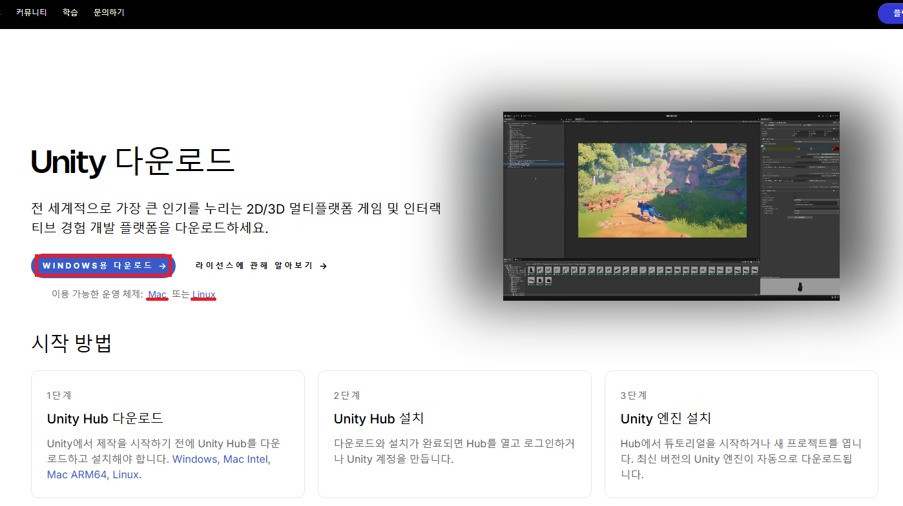
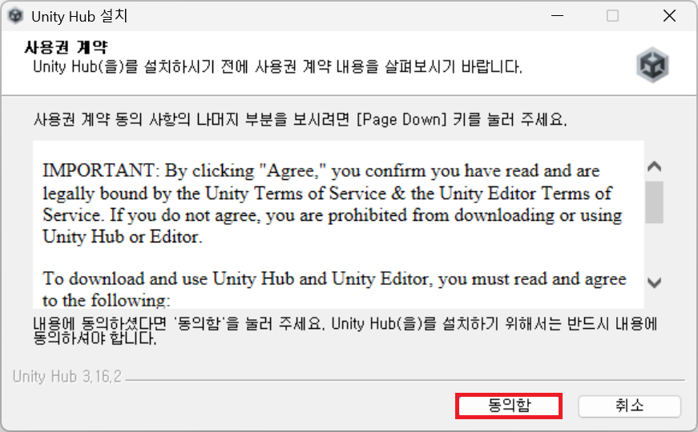
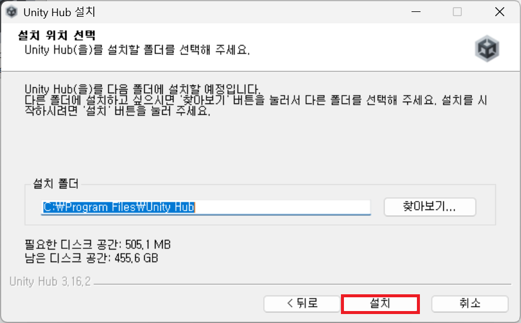
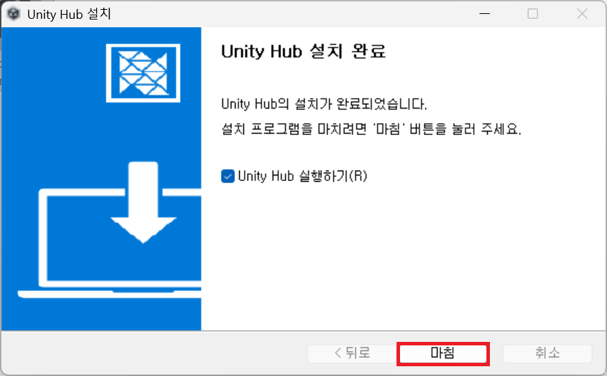
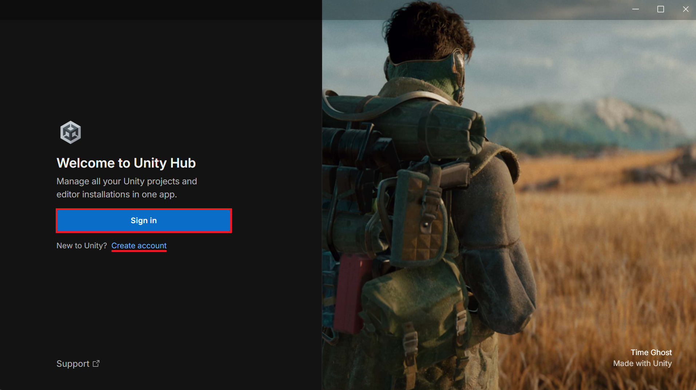
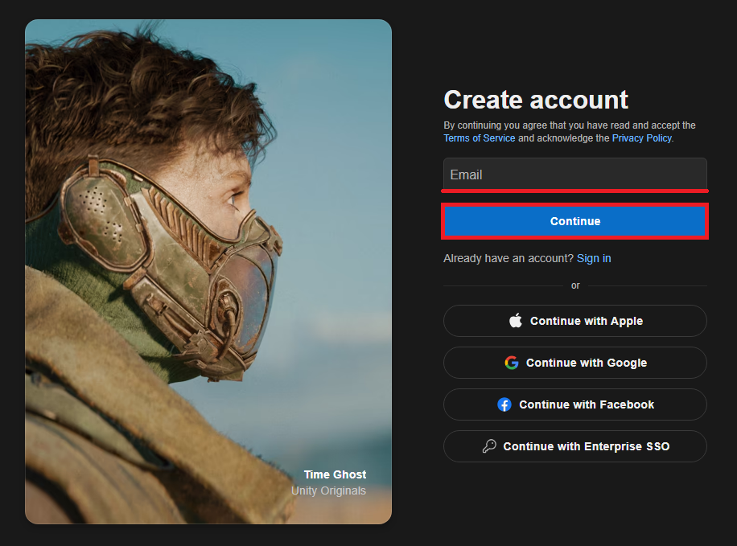
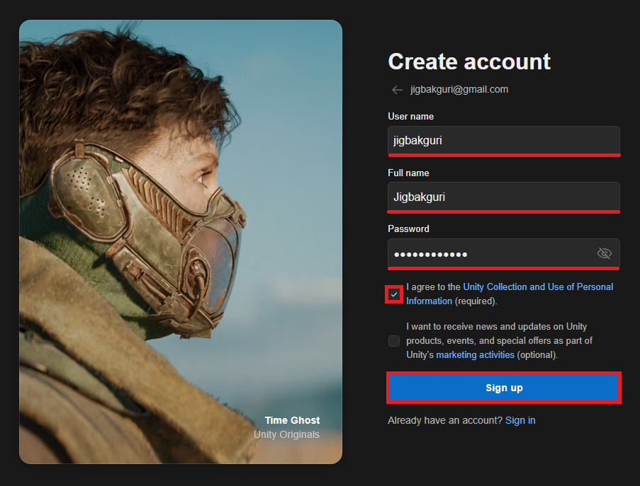
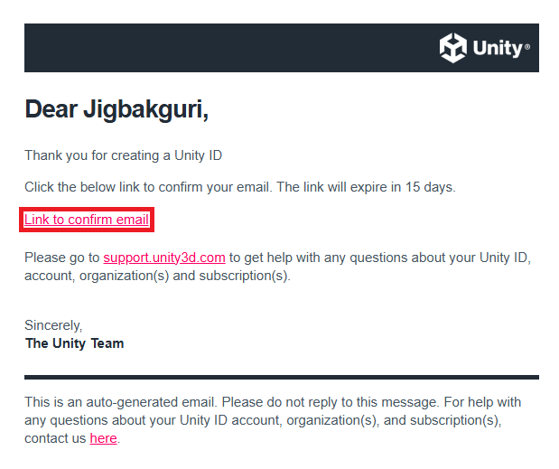
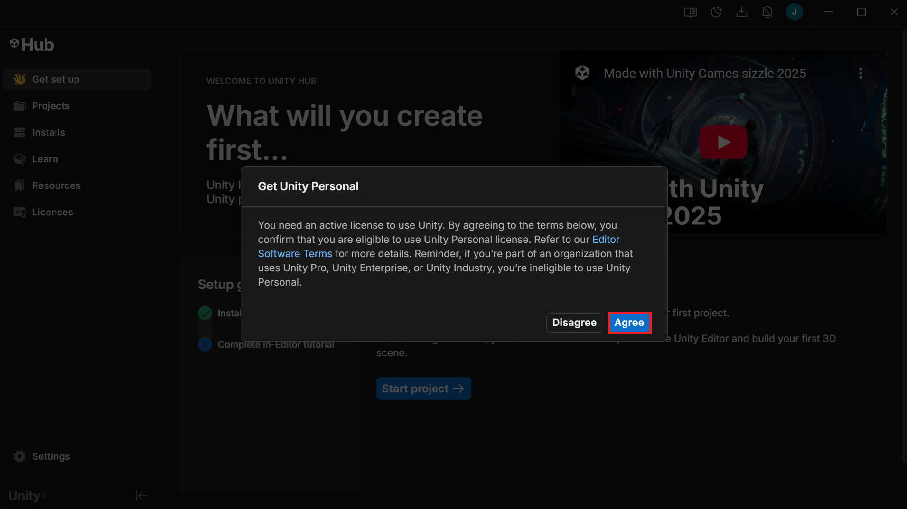
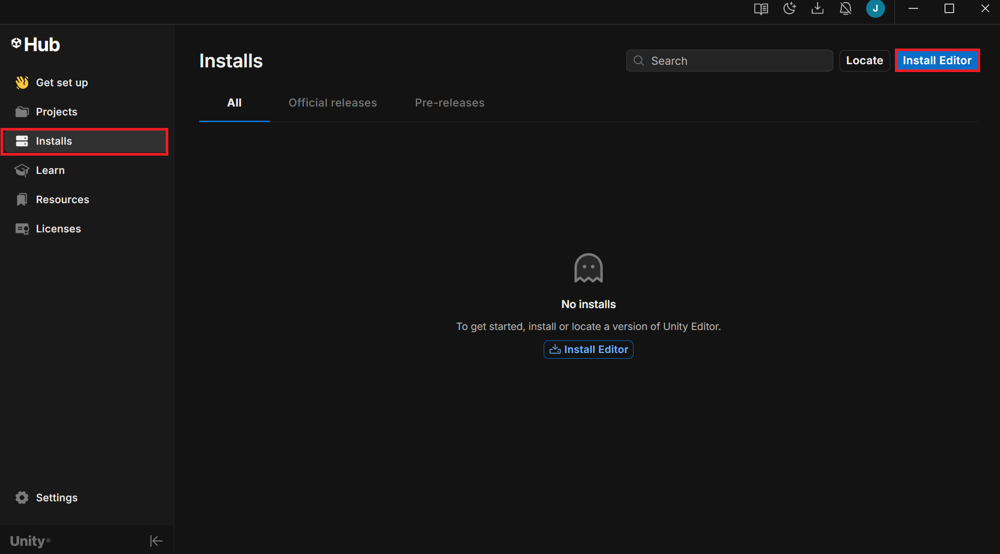

> In this entry
> - What Unity is
> - Installing Unity Hub
> - Creating an account
> - Installing the Unity Editor

## What is Unity?

If you have thought about making a game, you have probably heard of **Unity**. But if you are completely new to development, it may not be clear what it does or how the pieces fit together.

*An example of a Unity game’s startup screen. Its appearance depends on the version and project settings.*

Unity is a **game engine**: software that provides many of the building blocks needed to create a game, such as:

- Rendering 3D objects
- Calculating physical collisions
- Playing animations
- Producing sound
- Building a playable application

An engine saves us from implementing every one of these systems from scratch.

### Why choose Unity?

Other engines include Godot, Unreal Engine, and GameMaker. Unity is one accessible option because it supports both 2D and 3D development, targets platforms such as mobile, PC, and consoles, and has a large collection of learning resources and tutorials.

Games made with Unity include Pokémon GO, Genshin Impact, Hollow Knight, and Among Us. Its uses span different genres and project sizes.

## Installing Unity

Once you have decided to try Unity, start by installing its management application.

### 1. Install Unity Hub

**Unity Hub** manages editor versions and projects. Download the installer for your operating system from the [official download page](https://unity.com/download).

Run the downloaded file, review the terms, and follow the installer.

### 2. Create a Unity account

Launch Hub after installation. Choose **Sign in** if you already have an account, or **Create account** if you do not.

Register with an email address or a supported external account. The **Full name** field is part of the account information form.

Complete email verification using the message sent to your address.

Hub may then ask you to activate a **Personal license**. Unity Personal is free for eligible users, but being an individual developer does not automatically establish eligibility. Check the current [Unity Personal requirements](https://unity.com/products/unity-personal) and [Editor terms](https://unity.com/legal/editor-terms-of-service/software), including the applicable revenue and funding conditions over the previous 12 months.

If the license requires renewal later, confirm that you still meet the conditions before renewing it.

### 3. Install the Unity Editor

The **Unity Editor** is where you actually build the game. In Hub, open **Installs** and choose **Install Editor**.

For a new project, an available supported **LTS (Long Term Support)** release is a reasonable starting point. When following a course or opening an existing project, first check which editor version it expects.

1. Choose an editor version.
2. Select the modules you need. Prepare a C# development environment, and add the relevant Build Support modules if you intend to target platforms such as Android. Modules can also be added later.
3. Review the license terms and complete installation.
4. Open **Projects → New project**, choose the installed editor and a template, then set the project name and location.
5. Open the project and confirm that the editor starts correctly.

Menu names and available releases can change as Hub is updated. See the [Unity Hub documentation](https://docs.unity.com/en-us/hub) for current installation instructions.
